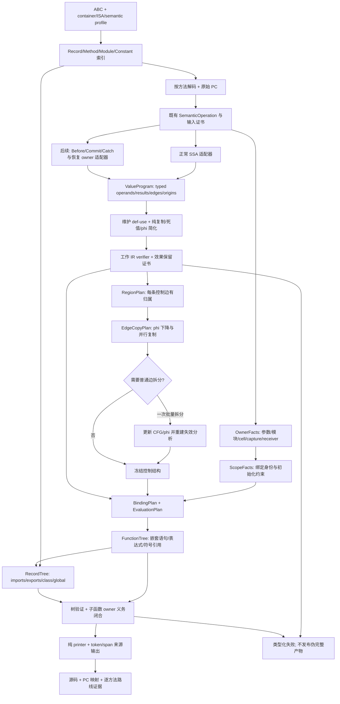

# 通用源码恢复设计与实施入口

版本：2026-09-25，设计基线 `f922648`；状态：已授权实施，当前推进 T07，尚未阶段验收。
最新事实与设计对照见 [进展看板](status.md)，历史证据见 [实施记录](progress.md)。
本包是对 [通用贯通概念方案](../unified-source-pipeline.md) 的复审和实施细化。
文档中的新类型、文件、CLI 选项和验收目标均为拟实现合同，除非明确标记“现有”。

## 1. 阅读与执行顺序

| 文档 | 用途 | 谁必须读 |
|---|---|---|
| 本文 | 总体架构、范围、迁移决策、里程碑 | 所有实施者和审查者 |
| [值 IR 与证明合同](value-ir.md) | 导入、效果、变换、修订、异常、预算 | 分析层和优化实施者 |
| [源码恢复与 AST 合同](source-tree.md) | 绑定、表达式、区域、去 SSA、源码树、printer | 源码层实施者 |
| [验收与交接合同](acceptance.md) | 样本、反例、证据、失败处理、交接模板 | 所有人 |
| [全样本能力与覆盖路线](corpus.md) | 全语料范围、跨应用/版本、留出集、持续能力扩展 | 所有人 |
| [分阶段实施计划](../../superpowers/plans/2026-09-25-unified-source-recovery.md) | 任务编号、文件职责、依赖、步骤、提交边界 | 执行与调度 agent |

发生冲突时：最新用户指令 > 根目录 AGENTS.md 及适用专项合同 > 本包 > 旧概念方案。
不能借此覆盖其他仍有效的专项语义证明。本包尚未实现的接口不能当作代码事实引用。

## 2. 复审结论

**兼容最初设计，属于 P2 语义分析到 P3 源码恢复之间的缺失主干，不是新建第二个反编译器。**
保留解码、profile、语义提升、已验证的 CFG/SSA/环境和 owner 证明；增加可维护值 IR，
把绑定和求值恢复从 printer 前的局部模式链提升成统一规划，最终输出真正的源码树。

**目标是覆盖全部样本并能处理新应用的通用反编译引擎；pasteboard 只是首个纵向切片。**
实现支持域由 typed operation/profile/控制/owner 前提定义，不由应用名、方法名、实体号
或某个示例的指令排列定义。全 corpus 的清单和能力缺口从 T00 建立，而非最后才扩范围。

此次复审对旧方案作六项收紧：

1. SSA read ordinal 不是源码操作数顺序。逐 `SemanticOperation` 建立显式导入合同。
2. `SemanticEffects` 是效果分类，不是已经实现的效果 SSA。先建立保守顺序约束，
   不以“有 bitmask”为由移动 getter、调用、guard 或分配。
3. 原 `SemanticProof` 只证明未变更输入。原证书与工作 IR 修订分开，变换有独立验证。
4. 第一个切片只导入正常控制流，不处理 handler、闭包、恢复点或 live 非平凡 phi；
   不宣称它覆盖完整异常 CFG。后续阶段明确扩展能力。
5. 区域/去 SSA 不做无界相互迭代：先冻结可覆盖边的控制计划，再在边上放置复制，
   需要拆边时批量执行一次并重建相关分析；无法结构化则明确拒绝。
6. 新路线必须逐方法、逐子方法留证据；`--shared-source` 或顶层调用新 printer
   都不等于完整新路线。要求新路线时禁止旧 writer 默默补正文。

## 3. 目标、非目标与当前授权

### 3.1 可观察目标

- 参数引用直接使用参数绑定；默认参数恢复后仍能消除参数搬运。
- 普通函数、箭头、方法、构造器共用值恢复和源码树，构造器仅增加接收者约束。
- `$acc`/寄存器仅作为内部输入状态；最终树不存在寄存器操作节点。
- 局部声明由真实多次使用、跨控制流合流、求值快照或共享 cell 的需求决定。
- 分支、循环、异常、捕获、模块 live binding 的身份、执行次数和求值顺序保真。
- 保留所有可观察属性读写、调用及异常；必要的临时变量允许存在并给出类型化原因。
- record 的路径、imports/exports、类、实例字段、全局和完整签名与函数体整合，
  不以“只导出了元数据”宣布原先结构优先 gate 完成。
- 所有生成位置来自 IR 来源，不从生成文本猜 PC，不使用 sourcesMap.map。

### 3.2 本轮不做

原设计交付阶段已结束，现按已授权的 T00–T12 计划实施。T00–T03 不扩 opcode；后续缺少的指令提升能力按
[跨样本能力任务](corpus.md) 单独补齐，不禁止为通用覆盖所必需的语义扩展。
不实现方法任务调度器；不全库重构；
不引入 LLVM/MLIR 运行时依赖；不通过替换打印字符串清除临时变量；不读取配对源码。
不追求恢复被擦除的 TS 类型、原始变量拼写、注释或与作者源码逐字一致。

用户已暂停测试、生成 JS 执行、基准和 RSS 跟踪。计划保留这些验收门槛，但不得
擅自恢复执行。暂停期间允许编写实现和测试规格、生产构建、ABC-only 产物检查；
只能报告“实现/构建/静态核对”，不得报告“等价验证通过/阶段验收通过”。
1,000,000,000 字节限制仍有效，不得以测试暂停视为豁免或声称已达标。

### 3.3 语义契约

沿用 `include/abcd/source/source_contract.h` 的 `kLanguageAndHostV2`：合法 JS/ArkTS
及合规宿主的正常返回、抛出不泄露 VM 内部标记；稳定且不被遮蔽的 globalThis；
排除 VM 内部资源耗尽差异。该前提必须带版本写入产物，不是从 ABC 推导出的事实。
反编译器自身内存限制不在豁免范围内。不得进一步假定任意基类不是 Proxy；
EntryAbility/EntryBackupAbility 的已知构造器拒绝不能为覆盖率直接取消。

## 4. 总体流程

异常/挂起不是普通边的别名。首阶段 N 只接收无 handler/恢复协议的方法；
即使没有 handler，may-throw 操作仍有“异常退出函数”结果及 before-throw 效果。
最终主干通过 X 扩展，不需要推倒 N 或把完整图伪装成正常图。

## 5. 各层责任与冻结点

| 层 | 输入 → 输出 | 不得承担 |
|---|---|---|
| Input adapter | 不可变 ABC/语义/SSA/证书 → 工作值图 | 从 SSA 序号猜调用顺序 |
| Value transforms | 值图 → 修订后的值图及变换记录 | 依据变量名、源码字符串匹配 |
| RegionPlan | CFG → 覆盖全部边的结构化控制 | 把 block 当词法 scope |
| ScopeFacts | ABI/环境/capture/module → 绑定身份约束 | 从 scope 名称推断初始化 |
| EdgeCopyPlan | phi/边 → 同时赋值及放置点 | 在异常边插普通 JS 语句 |
| BindingPlan | 值使用和 scope → SymbolId/声明位置 | 为每个寄存器生成一个 let |
| EvaluationPlan | 值依赖、效果顺序 → 一次性求值归属 | 凭单次使用就跨分支内联 |
| SourceTree | 冻结的计划 → 有绑定的嵌套语法树 | 留 phi/staged call 让 printer 补 |
| Tree verifier | 树+证书 → 可打印且 owner 义务闭合 | 仅通过语法检查便声称等价 |
| Printer | 已验证树 → bytes/spans | 递归反编译、补变量、修改控制流 |

冻结点为：输入事实、每批 IR 修订、控制边放置、绑定/求值计划、完整函数树、完整 record。
冻结对象不能隐式修改；涉及变化必须生成新修订并使下游依赖失效。

## 6. 现有代码接入地图

| 现有位置 | 处理方式 |
|---|---|
| `analysis/semantic_ir.h`、`register_ssa.h` | 保持输入模型，新增适配器，不直接把 SsaValueId 改名 |
| `analysis/instruction_ssa.h`、`exception_flow.h` | 后续 phased 导入；区分原指令与相位节点坐标 |
| `analysis/environment_flow.h`、`semantic_validation.h` | 保留原事实和证明的适用条件，导出 OwnerFacts |
| `src/source/semantic_body.cc::BuildBody` | 在输入验证后、旧 BuildSourceAst 前分流到新构建器 |
| `src/source/semantic_entry.cc::BuildEntrySource` | 复用同一构建器，以 entry 上下文提供模块/类事实 |
| `src/source/base_function.cc::BodyWriter::Write` | 传递路线策略、完整签名及诊断；禁止要求新路线时回退 |
| `src/source/record_source.cc::BuildRecordSource` | record 组合入口，最终消费 RecordTree |
| `src/source/semantic_ast.cc` | 旧折叠链保留为旧路径；新路径不能先调用再包装成树 |
| `src/source/semantic_printer.cc` | 旧 printer 保留；递归 child/capture 义务迁至新树构建阶段 |
| `src/source/record_program.cc` | 明确为旧 `--source` 路径，不继续堆通用优化 |
| `tools/abc_structure.cc`、`tools/semantic_survey.cc` | 路线策略、逐方法阶段证据、失败及输出完整性 |

这些是接入位置，不是授权无关重构清单。具体新文件见实施计划。

## 7. 里程碑与止损线

| 阶段 | 可交付结果 | 完成门槛 | 不得冒充 |
|---|---|---|---|
| G0 | 身份、路线、输入能力表、类型化拒绝 | 强制新路线失败不落旧 writer | 反编译成功 |
| G1 | PageA 7586 首片及独立应用同能力方法 | 参数无搬运；两次 getter 保留；PC 来源闭合；不按样本特判 | 含调用/异常完整贯通 |
| G2 | 普通调用、phi/循环、共同参数恢复 | 调用 reference 顺序；真合流及复制环正确 | closure/async 已支持 |
| G3 | cell/捕获/构造器和类/模块接入 | 与普通函数共用树；三项用户清理目标闭合 | 两个宿主构造器被证明 |
| G4 | 同一真实复杂函数全程；异常/async 扩展 | 7366 能力审计后完整走新路；异常/挂起语义保留 | 用两个简单方法拼成一个切片 |
| G5 | 全 corpus 分类、跨应用/profile 的统一输出审计 | 全文件/record/method 无漏项；留出集和历史 profile；pasteboard 仅子集 | 分类完整即全部反编译完成 |
| G6 | 持续消除全 corpus 动态方法/record 的能力缺口 | 在明确版本/契约范围内全部目标动态样本真实源码成功；新样本回归机制生效 | 静态 skip、未知版本、拒绝或 metadata 计成功 |

G1 是最早纵向集成，不等待 G2/G3 全部完成。G4 的异常/async 可分子门槛，
7366 是否包含该能力由 ABC 审计确定，不预先假定。若候选指令超出当前能力，
先记录精确阻塞与对应任务，不换简单样本宣布原门槛完成。
每个阶段都要求 acceptance.md 中对应验证；暂停的验证意味着 gate 仍未通过。
G1–G4 每增加通用能力，都需跨应用证据或明确“缺真实样本、泛化未验证”，不能等 G5
才发现只支持 pasteboard。G6 是总目标；T00–T12 交付主干和全量差距，不能冒称 G6 完成。

## 8. 算法选择与工程取舍

沿用 [算法合同](../algorithms.md)，不重写已正确的 LT 支配树、pruned SSA 或环境分析。
新增部分采用稀疏 def-use/worklist、SSA edge parallel copies、分离 binding/evaluation
规划及 typed tree。算法成功的前提是输入/副作用合同正确，不是名字相同就正确。

- 不做通用 CSE/GVN、属性 load 消除或 aggressive coalescing 作为首期依赖。
- 不建变量两两干涉图；先给非平凡 phi 保守独立绑定，允许多几个必要变量。
- 不强求重建作者的 for 语法；while+合法 break/continue 可以是正确结构化结果。
- 不用代码复制解决不可约 CFG；首期显式拒绝，后续另立有界状态机方案并审查可读性。
- 工作量/内存不足返回资源失败，不静默减少证明、裁剪 PC 来源或切换错误语义。

LLVM 的 [phi 语义](https://llvm.org/docs/LangRef.html#phi-instruction) 支持边归属的建模，
[MemorySSA](https://llvm.org/docs/MemorySSA.html) 可供“效果版本不是标量变量”的架构参考；
二者不能直接证明 JS getter/Proxy/异常语义。语法目录参考
[ESTree](https://github.com/estree/estree/blob/master/es2015.md)，不是要求 JSON AST 或新增依赖。
实现如复制第三方代码，必须另行固定版本、许可证及维护责任；只参考算法不伪报依赖版本。

## 9. 交付质量的优先顺序

语义正确 > 证明/来源可核验 > 可分析的结构 > 参数/局部可读性 > 少临时变量 > 文本相似。
无法证明可内联时保留有理由的局部变量，不为漂亮输出删除效果或扩大宿主前提。
输出审查同时看“为什么仍有临时量”和“为什么这次消除安全”，不能只统计行数下降。
