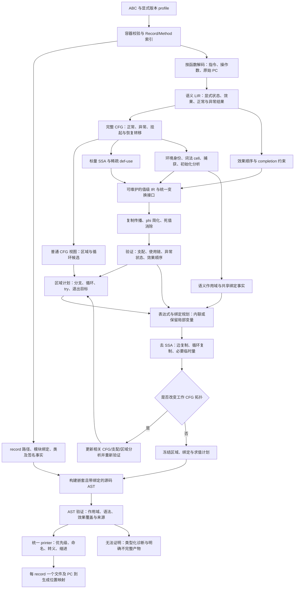
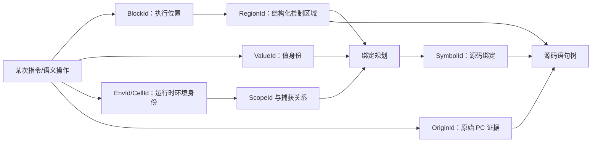
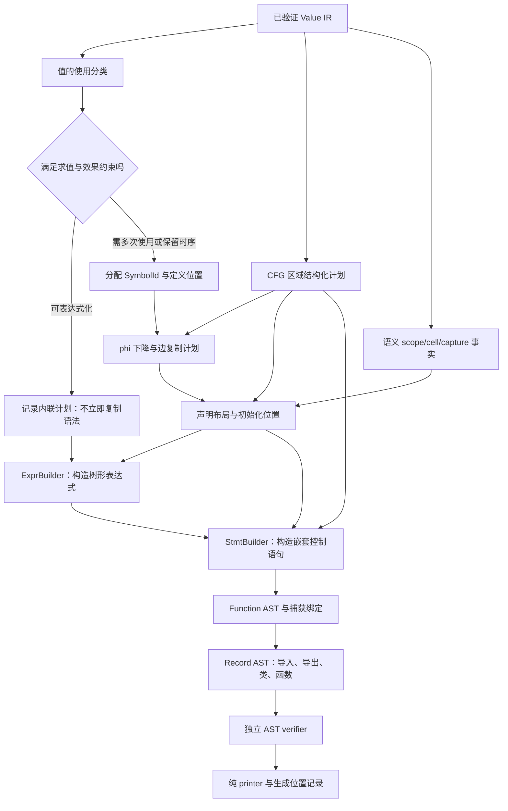

# 通用贯通中的值恢复、作用域与源码 AST

状态：设计说明与迁移建议，不表示下述主干已经实现。本次只补充文档。

实施请以 [2026-09-25 复审设计包](source-recovery/README.md) 为入口：其中包含
值 IR/证明合同、源码 AST/绑定合同、验收矩阵及逐任务实施计划。本文保留概念背景，
阶段边界以复审包为准：首切片仅正常流，非平凡 phi、异常相位和捕获分阶段接入；
不得把 SSA read ordinal 当语法求值顺序，或把旧输入证明直接用于改写后的工作 IR。
pasteboard 仅为启动切片；覆盖目标是两个样本目录的全部输入及新应用，详见
[全样本能力与覆盖路线](source-recovery/corpus.md)，不能把单应用的完成当通用引擎完成。

## 1. 与最初设计的关系

兼容，而且本来就是通用贯通的一部分，并非另建优化器或另开构造器路径。

最初设计 [总体流水线](../superpowers/specs/2026-09-22-abc-decompiler-design.md)
第 5 节规定了 LIR → SSA 与环境/效果分析 → 控制流区域 → 源码 AST → printer。
第 7.1～7.5 节已明确两级 IR、正常/完整 CFG、去 SSA、词法 cell 与调用顺序。
本方案细化这些既有责任，主要补齐 P2 的可维护分析与 P3 的源码恢复接口。
当前已经有部分 P3 输出，不能据此认定 P2 的通用基础全部完成。

继续沿用：版本 profile、ABC 解析、record 路径、模块/类元数据、现有语义契约、
CFG/SSA/异常/环境分析成果。需要补强：可变换的值级 IR、分析失效管理、统一绑定
计划、真正嵌套的源码 AST。保留旧输出路径作为迁移对照，而不是无限增加分支。

最新约束继续优先于早期文档：不读配对源码或 sourcesMap.map；调度器暂缓；
测试、生成 JS 执行和 RSS 跟踪仍暂停；1,000,000,000 字节上限仍有效但未经新验证。

## 2. 总体流程图



图中的反馈是受预算约束的规划调整，不是无界 fixed-point 重写。
首个实现切片禁止 CFG 拓扑优化；需要拆边的构造单独拒绝或进入已验证降级路径，
随后再补相应能力。不会为提高覆盖率不断重复整个流水线。

环境和效果分析不是最后补上的注释：它们从语义提升开始约束每一次值变换。
record 层负责组合模块、类和函数 AST，不重新拼接另一套函数体文本。

## 3. 必须分开的四种结构

| 结构 | 解决的问题 | 不能承担的职责 |
|---|---|---|
| CFG/basic block | 哪条控制转移能到哪里；抛出点与正常结果的可见性 | 不能把每个块当成一个词法 scope |
| SSA/value graph | 每次使用具体来自哪个定义 | 不能把每个 SSA 值等同一个源码变量 |
| Scope tree + capture edges | 名称绑定、可见性、共享 cell、生命周期 | 不能由支配树或花括号机械推导 |
| Region tree/source AST | 控制如何结构化、源码如何嵌套 | 不能丢掉未被自然结构覆盖的 CFG 边 |

一个函数 scope 通常跨多个基本块；一个 if 也可能包含许多块。
一个源码 block 可以容纳多个 CFG block；一个具有多个抛出点的源码语句在完整
CFG 中也可能对应多个分析节点。因此这些结构不是一一对应关系。

程序点另外关联：所属函数、语义环境、异常保护上下文、效果位置与 OriginId。
按需要用分段表/侧表存储，不给每个源码节点复制整套分析图。



## 4. 如何保护 basic block 与 scope

### CFG 合同

保留不可变输入语义与来源索引；工作 IR 使用独立的稳定强类型 ID。
这是身份/版本隔离，不要求常驻两份完整数据拷贝。

首轮复制传播只改 ValueId 使用，不合并/删除块，不更换 handler，不跨挂起点。
表达式内联先做计划：必须保持条件执行、效果顺序、保护范围及可用定义。
仅有单次使用或定义支配使用，不足以证明可以内联。

例如把 if 内的 getter 提到 if 外，会新增原来不发生的求值，即使值只使用一次
也不允许。把读取移进 try 则可能改变谁捕获异常，同样不允许。

需要在 critical edge 放 phi 复制时，只能通过统一 CFG 编辑接口拆分普通边。
更新/失效支配树、循环/区域计划及来源关系后再使用分析结果；禁止继续拿旧
BlockId 顺序或旧 instruction index 作为有效证明。异常边不能插入普通语句块
来假装处理了复制，必须有独立异常状态下降方案。

### Scope 合同

先恢复参数、环境 cell、捕获及模块绑定的语义身份，再决定输出声明位置。
同名不代表同绑定；同一个寄存器在不同生命周期也可能对应不同变量。
反过来，一个变量在字节码中可以经过许多寄存器和 SSA 版本。

ScopeId 表示源码绑定环境，SymbolId 表示绑定，CellId 表示共享可变存储。
可变闭包 cell、模块 live binding、heap 属性不当作普通标量值做复制替换。
声明位置选择需同时满足可见性、TDZ、初始化时点、循环逐迭代身份、catch 参数
及捕获关系。不能简单把所有 let 提到函数头，也不能只用支配树 LCA 定义 scope。

纯编译器临时量可在经证明安全的共同作用域声明，但保留原求值位置的赋值；
用户可观察的绑定身份/初始化规则不能因此改变。

函数共享一种模型，CallableKind 区分普通函数、箭头、方法、构造器等。
this/new.target 的拥有者显式记录；箭头引用外层拥有者。构造器只添加 super 前
不可用等约束，不拥有专门的一套表达式构建器。

### 每次变换的验证

| 变更 | 必须更新/检查 |
|---|---|
| 替换值使用 | use list、操作数类型、定义支配使用、phi 边身份 |
| 删除操作 | 无可观察结果/效果/异常；来源有明确去向 |
| 调整求值 | 效果依赖、条件执行次数、保护上下文、引用/接收者语义 |
| 修改边或终结点 | 前驱/后继、phi、支配/循环/区域分析失效 |
| 合并源码绑定 | 生命周期、TDZ、共享 cell、捕获与命名冲突 |

生产路径采用变换内局部不变量检查和阶段末整体验证，避免每删一个节点就全图
扫描。分析结果带所属 IR 修订/失效状态，禁止缓存旧证明继续使用。

## 5. 生成源码之前需要什么 AST

需要“已绑定、已结构化、求值顺序确定的源码 AST”，而不是按字节码顺序排列的
语句数组，也不是把 SSA 图直接递归打印出来。

现有 `SourceAst` 是过渡表示：含 RegionTree、平铺 SourceStatement、寄存器目标、
staged argument 区间和 fused origins；这有用，但仍混合低层恢复和源码生成。
建议先新增内部 SourceTree 作为最终输出边界，旧 SourceAst 不立即全量重写。

语法节点分类参考 [ESTree](https://github.com/estree/estree/blob/master/es2015.md)，
内部采用 C++20 强类型 ID、枚举、variant；不使用 JSON 对象或语义字符串标签。
不要求引入 ESTree 运行时依赖，也不把现有源码先打印再解析成树。

| 层次 | 需要的节点/记录 |
|---|---|
| 文件 | Module、Import、Export、顶层声明、类及函数 |
| 函数 | CallableKind、参数/默认值/rest、ScopeId、函数体、this 拥有者 |
| 绑定 | SymbolId、声明类别、所属 scope、捕获关系、名称来源 |
| 语句 | Block、Declaration、ExpressionStmt、If、While/For、Return、Throw、Try、Label、Break、Continue |
| 表达式 | Literal、SymbolRef、This、Member、Call、New、Unary、Binary、Logical、Conditional、Assignment、Await、Function、Class |
| 赋值目标 | LocalTarget、MemberTarget、合法 binding pattern；不能任意 Expr 都作左值 |
| 类成员 | 方法/getter/setter、构造器及有语义证据的字段；不把 register 或 record metadata 当字段 |
| 来源侧表 | NodeId → OriginId → method/PC 集合、重写来源与消除原因 |

语法目录是目标接口，不宣称全部语法已可恢复。JS 优先；无证据不补 TS 泛型、
interface 或 import type。字段声明若改变初始化次序，仍保留构造器赋值。

### 最终 AST 的硬边界

- 表达式操作数引用 ExprId 或 SymbolId，不通过 RegisterId、acc 或打印字符串寻址。
- 语句体引用 StmtId 列表，if/loop/try 真正嵌套，不在 printer 中再搜指令区间。
- phi、未决控制转移、隐式参数准备协议必须在 AST 构建前处理，不能交给 printer 猜。
- 一次有副作用的求值只有一个语法出现位置；IR 可以共享 ValueId，但 AST 不能因
  多处引用同一 ExprId 就重复打印同一个 getter。多次使用通过 SymbolRef 表达。
- 调用节点区分成员调用、普通调用、super/new 等已经合法化的形式，不能把
  任意 Invoke(callee, receiver) 硬转成 `.call`；不能忽略 callee 引用获取时点。
- 显式临时变量允许存在，但它们是正常 SymbolId 绑定，不是泄漏 VM 物理槽。
- 不支持节点不能伪造可执行函数体；给出类型化失败及明确不完整的结构产物。

## 6. 如何构建这样的 AST



构建步骤：

1. 复制传播、phi 简化和死值删除在统一 Value IR 完成，更新 use list 和效果事实。
2. 结合区域及语义 scope 生成 BindingPlan；SSA 版本不机械一对一生成变量。
3. ExpressionPlan 标记值是内联、具名、保留存储还是必须拒绝；代价包括重复展开
   的输出量，不能为“漂亮”生成指数级表达式。
4. 去 SSA 的并行复制按边规划，处理循环复制的临时量。需要变更 CFG 时先更新
   分析再冻结区域，不能一边打印 if 一边在已过期的边上补赋值。
5. ExprBuilder 按已经确定的计划生成节点，处理运算优先级所需的树结构，而不是
   返回 JS 字符串。StmtBuilder 依据区域生成 Block/If/Loop/Try 及合法退出目标。
6. 完成默认参数环境、声明位置、captures、this 所属、module live binding 等验证。
7. AST 冻结后 printer 只做语法排版、名字选择/转义及位置记录，不再决定是否
   删除值、移动副作用、建立类归属或恢复闭包。

建议内部边界是 `BuildFunctionTree(ValueProgram, RegionPlan, BindingPlan)`，
返回树或类型化失败。参数对象是经验证的阶段产物，不是字符串配置包。
按值 IR、绑定计划、表达式构建、语句构建、AST 验证、printer 分文件；优先沿用
现有 analysis/source 模块边界，不一次性另建大框架。

函数级 arena/紧凑数组持有节点，ExprId/StmtId/SymbolId 分类型。列表用有界
子节点范围或可计费容器，不逐节点无界分配。保留纯语法树的独立性，分析图可在
阶段结束后释放，避免同时常驻完整旧/新 IR、全部 AST 和整份输出字符串。

## 7. 一个具体例子

输入语义里可能有：读取参数字段到 acc、复制到 r5、和 undefined 比较、分支，
进入分支后再次读取字段并写入 this。

在 Value IR 中，两次属性读取是两个不同的操作，有各自的 ValueId 与效果位置；
不能因为属性名相同就公共子表达式消除。第一次值用于条件，第二次值用于赋值。
中间寄存器复制没有独立源码意义，按值使用关系消除。

最终 AST 形状：

```text
Function(method, scope=S, params=[P])
  Block
    If
      test: StrictNotEqual
        Member(SymbolRef(P), pathStack)
        Undefined
      then: Block
        ExpressionStmt
          Assignment
            MemberTarget(This(owner=method), pathStack)
            Member(SymbolRef(P), pathStack)
```

这个树里没有 acc、r5、phi，也没有“字符串 this”；有两处真实属性读取。
对应若干基本块的控制边由 RegionPlan 提供证据，节点的 OriginId 保留两次读取
和比较/写入各自的 PC。源码变量名只是绑定表的文本属性。

## 8. 位置映射与迁移

映射目标是多对多关系：一个 AST 表达式可覆盖多个 PC；一个语义操作也可能在
合法下降后对应多个生成区间。使用共享 OriginId/有界来源表，避免每次合并都
复制整个 PC 集合而退化。消除操作记录类型化原因及归属节点或零宽锚点。
只有 printer 知道最终字节/行/列，边输出边记录，绝不在生成文本中反查。

迁移按以下阶段推进：

| 阶段 | 交付边界 | 不做什么 |
|---|---|---|
| A 值级主干 | 同步函数、现有块拓扑、稳定 ValueId/use list、统一变换验证 | 不继续按样本加替换规则 |
| B 通用变量恢复 | 所有相关值的稀疏复制传播/phi 简化/绑定规划 | 不为每个寄存器重跑整个 CFG |
| C 最终源码树 | 一个带分支、属性副作用及调用的真实方法贯通到 SourceTree/printer/PC 映射 | 不宣称整个应用完成 |
| D 所有权扩展 | 普通方法、构造器、闭包、异常、async 逐项接入既有语义合同 | 不放宽宿主假设来凑覆盖率 |
| E record 集成 | 模块/类统一消费函数树，旧路径逐项退出 | 不推倒解析层、profile 或元数据索引 |

旧专项路径暂留作迁移对照，不在新主干后继续重复执行两套语义优化。新主干失败
时只能使用本身独立有证据的旧路径，不能静默输出假函数体；产物需记录所走路径。

验收标准是同一个真实函数确实经过 Value IR、scope/effects、区域、绑定、源码
AST、printer 与来源映射，并满足相应行为验证。当前测试暂停期间只能报告结构、
构建和静态审查证据；行为等价验收需待恢复验证后完成。

## 9. 算法参考与限度

沿用 [算法专项设计](algorithms.md) 的支配、IDF、稀疏 use 链和边复制策略。
SSA 的 phi 与支配约束可对照 [LLVM IR 说明](https://llvm.org/docs/LangRef.html#phi-instruction)。
内存依赖的独立分析思想可参考 [MemorySSA](https://llvm.org/docs/MemorySSA.html)，
但它不是 JS getter、异常和环境语义的现成证明，也不意味着引入 LLVM 依赖。

初版仍采用原设计的保守效果顺序，不提前建设复杂 heap alias 优化器。
多变量 phi 数量、捕获关系和输出大小必须单独计费；不承诺所有输入都线性。
不采用逐变量全图扫描、无预算的全量干涉矩阵或无界结构化复制。

这次调整的本质是把原设计中间几层的合同落实，不是改写项目目标，也不是把
scope/CFG 问题藏进 printer。语法更自然是结果，值、控制、作用域和效果可核验
才是迁移是否成功的依据。
