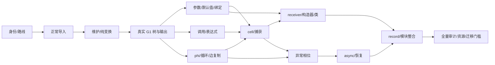

# Unified Source Recovery Implementation Plan

2026-09-28 优先修订：执行 [FunctionTree 与部分输出设计](../../design/source-recovery/function-tree-output.md)
和 [最新演进计划](2026-09-28-unified-control-regions.md)。下面 T00–T12 保留功能范围及
历史任务记录；新增预算/验证包装/发布 receipt/全面映射审计任务暂缓，不作为反编译
功能或部分输出的前置。允许直接打印 FunctionTree，并标记未恢复函数与区域。
用户后续明确要求默认产出不以 work 计数拒绝：关闭生产默认 work 配额，保留统计、
显式有限额度的底层兼容接口及独立的内存/输入安全检查，不再以调高小阈值作为功能修复。

> **For agentic workers:** 使用 `superpowers:executing-plans` 逐任务执行；只有获得委派授权时才使用 `superpowers:subagent-driven-development`。以下复选框记录实际交付，不表示本轮已实施。

**Goal:** 面向全部样本及新应用建立 Value IR → 绑定/求值规划 → SourceTree → 源码及 PC 映射的通用主干；pasteboard 仅作启动切片，优先恢复参数、局部、this/捕获和必要的表达式合并。

**Architecture:** 保留现有输入分析和旧路径作为明确标记的迁移对照。先通过正常控制流的真实小函数纵向集成，再扩展调用、合流、参数环境、捕获/构造器、异常/async、record 组合。所有源码恢复使用同一树模型和 printer。

**Tech Stack:** C++20、现有 CMake 目标 `abcd_analysis`/`abcd_source`、现有强类型/variant/Result 惯例；拟增加 CTest/C++/Node 回归，不新增 LLVM/MLIR 依赖。

---

## 0. 执行前提

- 基线 `f922648`，本设计包属于其后续文档提交；实施者先记录实际 HEAD 和工作树状态。
- 必读 [设计入口](../../design/source-recovery/README.md)、[IR 合同](../../design/source-recovery/value-ir.md)、
  [AST 合同](../../design/source-recovery/source-tree.md)、[验收合同](../../design/source-recovery/acceptance.md)、
  [全样本能力合同](../../design/source-recovery/corpus.md)。
- 当前允许相关定向单元/集成和受控完整生成 JS 行为测试；全量测试、基准和 RSS
  仍暂停。部分输出不作等价执行输入；未执行的命令和内存 gate 保持未验证。
- 不实现任务调度器，不新增宿主前提，不读取配对源码/sourcesMap.map，不特判样本 ID。
  各任务必须按全 corpus 的 typed capability 定义支持域，不按 pasteboard 代码形状定义。
- 新文件是拟创建路径；若已有同职责接口先复用并记录映射，不创建第二套含义相同的类型。
- 算法代码块是行为/接口合同，不是假装已经编译过的完整 C++ 补丁；每个任务先完成
  本任务小型可编译接口和具体回归，再提交实现。不能把伪代码直接存为生产代码。

## 1. 任务依赖与执行顺序



推荐串行顺序：T00 → T01 → T02 → T03 → **T06** → T04 → T05 → T07 → T08 →
T09 → T10 → T11 → T12。优先参数别名，保持普通函数与构造器共用能力。
T07 完成后先核对 7366，尽早满足同一复杂真实函数的端到端门槛，不等到 T12 才看输出。
T11 的 record receipt 外壳可在 T03 建立，但完整 RecordTree 要等待必要函数能力。
实际 ABC-only 复核补充：7366 创建的 7421 含异常区域及 async 转换；完整 P3
family 发布还依赖 T09/T10。保持原完整 P3 验收要求，T07 的局部进展不得冒充
该门槛通过；不得伪造或省略 async 子函数以提前通过。按后续依赖补齐后复验。
依赖图表示接口/语义依赖，不等于授权并行开工；共享入口/CMake 由一个集成者维护。

## 2. 文件责任地图

新 public headers 只暴露跨模块合同；单任务内部算法头放 src 同域，避免公共头膨胀。

| 任务 | 拟新增主体 | 责任 |
|---|---|---|
| T00 | `include/abcd/source/source_route.h`, `src/source/source_route.cc` | 路线策略、阶段 receipt、失败传递 |
| T01 | `include/abcd/analysis/value_ir.h`, `value_import.h`; `src/analysis/value_import.cc`, `value_verify.cc` | 工作 IR 及输入导入/验证 |
| T02 | `src/analysis/value_edits.{h,cc}`, `value_simplify.{h,cc}` | use 链维护、批次修订、纯优化 |
| T03 | `include/abcd/source/source_tree.h`; `src/source/function_tree.{h,cc}`, `tree_verify.cc`, `tree_printer.cc`, `source_origins.{h,cc}` | 最小函数树、验证、打印、来源 |
| T04 | `src/source/evaluation_plan.{h,cc}`, `call_plan.{h,cc}` | 表达式归属、调用 reference |
| T05 | `src/source/control_plan.{h,cc}`, `edge_copies.{h,cc}` | 区域与边归属、phi 下降 |
| T06 | `src/source/binding_plan.{h,cc}`, `parameter_plan.{h,cc}` | 符号/声明、参数前导与签名 |
| T07 | `src/source/scope_facts.{h,cc}`, `capture_plan.{h,cc}`, `literal_plan.{h,cc}` | cell/捕获及对象/数组初始化义务 |
| T08 | `src/source/receiver_plan.{h,cc}`, `class_tree.{h,cc}` | 接收者状态、类归属/组合 |
| T09 | `src/analysis/phased_value_import.{h,cc}`, `src/source/exception_plan.{h,cc}` | 异常图导入与 completion |
| T10 | `src/source/async_tree.{h,cc}` | 归一化 owner 到同一树的适配，不是独立 printer |
| T11 | `src/source/record_tree.{h,cc}`, `module_tree.{h,cc}` | record/module 组合与原子发布 |
| T12 | `tests/support/source/value_cases.{h,cc}`, `tests/integration/value_tree_corpus.cmake` | 对抗图/全量审计；无 production 依赖 |

表中 T01 的 `value_import.h` 路径同列前缀 `include/abcd/analysis/`；测试文件在各任务完整列出。
如新增头不跨模块使用，应收窄到 src，不为测试导出 production 私有接口。
所有新增 .cc 加入既有适当 library，不新建笼统 Manager/Utils 层。

## 3. 每个任务的固定提交协议

1. 读取指定旧入口/合同，写明输入前提、拒绝边界、数据规模和 ownership。
2. 添加列出的正反例 fixture/断言；暂停期间不执行，提交注明未验证。
3. 提交最小编译接口、实现、阶段 verifier、调用接线；不能只有未调用的库。
4. 在授权范围内执行生产构建/ABC-only 核对，记录实际结果和 receipt。
5. 恢复测试后构建该任务 test target 并用精确 CTest name 执行；负例必须按合同拒绝。
6. 检查 `git diff --check` 和 scope；只提交本任务相关文件。一个任务较大时拆成
   “合同+fixture”“实现+接线”两个可解释提交，不积累跨多个任务的未提交代码。

以下所有 test target/name 均为待创建，CMake target 与 CTest name 必须保持同名。
每个测试执行模板：`cmake --build build --target NAME -j2`，随后
`ctest --test-dir build -R '^NAME$' --output-on-failure`；预期退出 0 且各断言成立。
尚未建目标或未经授权时禁止宣称这些命令已执行。

## T00. 冻结身份、能力与路线

**目标：** 能证明某个方法进入了哪条路，以及为什么失败，不让旧 writer 掩盖缺能力。
**依赖：** 无。**验收：** A01/A03，G0。

**文件：** 新建 `source_route.h/.cc`（完整路径见地图）；修改
`src/source/base_function.cc`、`src/source/semantic_body.cc`、`src/source/semantic_entry.cc`、
`tools/abc_structure.cc`、`tools/abc_semantic.cc`、`tools/semantic_survey.cc`、`CMakeLists.txt`。
测试：`tests/unit/source/source_route_test.cc` → `source_route_test`。
样本合同：`tests/corpus/pasteboard-value-tree.json`，不改输入 ABC。
全样本合同：`tests/corpus/source-cohorts.json`、`docs/design/source-recovery/capabilities.md`；
引用现有 `tests/corpus/abc-index.json`，不复制静态分类缓存。

- [ ] 建两个 corpus 根的范围、内容去重、应用族/profile/开发/留出分组和能力表骨架，
  优先复用已有清单；测试暂停期间不启动批量验证，记录未刷新状态。
- [ ] 只读核对 pasteboard hash/entity，记录 P1/P2/P3 的 typed 操作能力清单；不读 paired source。
- [ ] 从其他应用为 G1/G2/G3 能力选独立真实方法；identity 未核实时标记未冻结，不能猜 entity。
- [ ] 定义 RoutePolicy/SourceRoute/SourceStage/receipt，版本化边界序列化和反向校验。
- [ ] CLI 新 `--value-source` 映射 RequireValueTree；方法 selector 按 entity ID，usage 记录
  与 `abc_semantic` 既有参数的兼容方案。未接通方法返回 typed unsupported，不输出假正文。
- [ ] 所有可进入旧 writer 的出口检查 policy；子方法继承 policy。不存在 receipt 的旧方法
  明确 Legacy，不把空 route 解释为 ValueTree。
- [ ] 增加故意失败的 fixture：新 route 失败而旧 writer 可成功，要求产物为新失败且无正文。
- [ ] 提交 `feat: add explicit source route receipts`，记录测试暂停状态。

```text
RequireValueTree + unsupported new stage => same typed failure, no legacy attempt
LegacyAllowed + legacy body => route Legacy, migrated false
missing child receipt => parent not complete
```

**关键风险：** `--shared-source` 当前走 record_source，不等于旧 `--source` 的
record_program；两者都需诚实标记，不可混用统计。

## T01. 只读输入到正常 ValueProgram

**目标：** typed operation/operand/result/site 完整导入，有一一可核对的输入关联。
**依赖：** T00。**验收：** V01/V02/V10；不要求生成源码。

**文件：** 新建 `include/abcd/analysis/value_ir.h`、`include/abcd/analysis/value_import.h`、
`src/analysis/value_import.cc`、`src/analysis/value_verify.cc`；修改 `CMakeLists.txt`。
测试：`tests/unit/analysis/value_import_test.cc` → `value_import_test`。
必读：`register_ssa.h`、`instruction_ssa.h`、`semantic_ir.h`、`semantic_validation.h`。

- [ ] 定义强 ID/arena/entry/op/phi/edge/use/origin 和 InputCorrespondence；禁止借用越界。
- [ ] 为 P1 所需各 SemanticOperation 写 role→原语义字段→read/write 表；非该能力集明确拒绝。
  同一 typed 能力对所有输入生效；为至少一个独立应用/profile 编写导入对照，缺样本如实记录。
- [ ] 建 block/value 索引，再导入 operands/results/phis；read occurrence 按实际操作映射。
- [ ] phi 输入保留 IncomingKey 的 MethodEntry/EdgeId 区分；入口循环 fixture 不可丢入口值。
- [ ] 无 handler 仍按 OpId 保存 may-throw exceptional exit/effect prefix；不能把同块多个
  抛出点合成一个块出口。handler/resume 拒绝 normal importer。
- [ ] 导入验证覆盖所有 input reads 的分类、writes、边、值域和 source identity。
- [ ] 构造 swapped ordinal/range 重复参数/未知 entry/profile mismatch 的正反例。
- [ ] 接入工具的 ValuesImported 阶段，不输出源码；提交 `feat: import normal semantic values`。

```text
for op in typed semantic operations:
  schema = exhaustive typed adapter(op)
  bind occurrences from schema and SSA read identities
  validate expected slots and results
  retain normal/exception effects and input-site correspondence
reject if any read/write/protocol dependency lacks classification
```

**完成标准：** P1 可导入且关联闭合；异常输入不能“正常导入成功”；不允许只建空类接口。

## T02. 维护 use 链、复制传播与死值清理

**目标：** 统一处理全部已接纳标量值，不再每次只消除一个寄存器模式。
**依赖：** T01。**验收：** V03–V06/V10/A04。

**文件：** `src/analysis/value_edits.{h,cc}`、`value_simplify.{h,cc}`；修改
`value_ir.h`、`value_verify.cc`、`value_import.cc`、`CMakeLists.txt`。
测试：`tests/unit/analysis/value_simplify_test.cc` → `value_simplify_test`。

- [ ] 实现 ReplaceUse/ErasePureOp/CommitEdits，维护双向 use 链和 IR revision。
- [ ] 用 canonical alias + 压缩实现 identity copy；一次遍历所有 occurrence，避免 n 长链反复全换。
- [ ] 在 alias canonicalize 后建 phi-only SCC/condensation，一次按依赖顺序处理唯一
  外部值的 trivial SCC；全 self 或无外部可用值拒绝化简。禁止每次 use 改变重扫全部 phi inputs。
- [ ] 从控制/效果/owner 根反向标活，删未标活纯 op；不能删 unused getter/call。
- [ ] 记录 ElidedPure/Combined 来源；资源不足 rollback，stale work proof 验证失败。
- [ ] fixture：长 copy 链、多寄存器、多 use、trivial phi、effectful unused、失效 revision。
- [ ] 接入 ValuesVerified 阶段；提交 `feat: simplify values with maintained use chains`。

```text
observable roots -> reverse def traversal -> retained set
dead result != dead operation
after committed edits: use symmetry + dominance + edge phi + effects + origins verified
```

**止损线：** 不做 load CSE/跨块 motion/非平凡 phi 下降；保留能力外结构并由下游明确拒绝。

## T03. 第一个真实函数贯通 SourceTree

**目标：** P1 同一方法依次经过 IR、变换、控制/绑定、树验证、printer、PC 映射。
**依赖：** T02。**验收：** S01/S03/S08/S09/A01/A03/A04，G1。

**文件：** `include/abcd/source/source_tree.h`、`src/source/function_tree.{h,cc}`、
`tree_verify.cc`、`tree_printer.cc`、`source_origins.{h,cc}`；修改
`semantic_body.cc`、`base_function.cc`、`semantic_entry.cc`、`CMakeLists.txt`。
测试：`tests/unit/source/source_tree_test.cc` → `source_tree_test`；
`tests/integration/value_tree_pagea.cc` → `value_tree_pagea_fixture`；
`tests/integration/value_tree_pagea.cmake`/`.mjs` → `value_tree_pagea_test`。

- [ ] 实现 Literal/SymbolRef/This/Member/Compare/Assignment 与 Block/If/Return/Expression。
- [ ] 建最小直线/if ControlPlan 及参数 BindingPlan；live 非平凡 phi typed reject。
- [ ] 引用 SSA entry 参数但不用寄存器作为树操作数；最小 pure/effect 顺序计划不可省略。
- [ ] 构建 verifier：scope、edge coverage、effect occurrence、tree ownership、origin coverage。
- [ ] printer 只接树/名字/预算，输出 token byte spans；不接受 SSA/MethodBody 做补救。
- [ ] 接线在 VerifySemanticSource 之后、旧 BuildSourceAst 之前；禁止先跑旧折叠链。
- [ ] 在 base_function 输出 header 前提供 FunctionEmission 的参数/receiver/self/arguments
  ABI census、签名与 origin 段；新路声明只由 BindingPlan 产生，不再打印旧 VM let。
  首片 capture/template 明确拒绝，不能返回看似完整的旧 PrintedTemplate。
- [ ] P1 ABC-only 导出 receipt；确认 pathStack 条件读和体内读是两个 occurrence，写 PC40 有映射。
- [ ] 独立应用同能力方法走同一入口；G1 泛化验收需 A08，不将 P1 单例当通用验证。
- [ ] 添加 count-changing getter fixture，两个读取返回不同值；预期写入第二次读取值，
  第一读为 undefined 时第二读与写入都不执行，第一/第二读抛异常各自截止。
- [ ] 提交 `feat: emit verified value trees for normal branches`。

```js
// 行为规格，不是生产模板；Undefined 的打印写法不作逐字要求。
function setInitiallyProvidedValue(params) {
  if (params.pathStack !== undefined) this.pathStack = params.pathStack;
}
```

**完成标准：** 无参数搬运/未使用 VM 声明，保留两次读取及映射；旧 record 外壳嵌入时
明确 method migrated / record incomplete。不声称 P1 包含调用或全 record 已完成。

## T06. 参数版本、默认签名与通用绑定

**目标：** 优先消除参数复制，包括恢复默认值后的参数；局部声明按使用/身份规划。
**依赖：** T03。**验收：** S01/S02/S06/A04。

**文件：** `src/source/binding_plan.{h,cc}`、`parameter_plan.{h,cc}`；修改
`function_tree.cc`、`source_tree.h`、`parameter_defaults.h` 及对应实现的必要适配、
`base_function.cc`、`tree_verify.cc`、`CMakeLists.txt`。
测试：`tests/unit/source/binding_plan_test.cc` → `binding_plan_test`；
`tests/unit/source/parameter_plan_test.cc` → `parameter_plan_test`。

- [ ] 创建 typed Symbol/Scope/NameEvidence/TemporaryReason，参数 ABI entry 绑定统一处理。
- [ ] 区分参数 entry 快照与参数可变当前值；多 use 或写后旧值保留合法 local。
- [ ] 建 scope ancestry/use occurrence 索引决定合成声明位置，不按变量全图扫描。
- [ ] 默认值证书传递到 Parameter 节点和 body 绑定；签名迁移记录 SignaturePlacement。
- [ ] 分离 ParameterScope/BodyScope/default initializer context，检查名称解析和 TDZ；
  mapped arguments/direct eval/with/strictness 不明时拒绝相关重写，不假定源 `.mjs` 总兼容。
- [ ] arguments/non-simple params/length/rest 无证明时不迁移默认值，保留原前导和 typed reason。
- [ ] fixture：`elmtId=-1`、显式 undefined 默认、参数改写后旧值使用、同名 shadow、rest。
- [ ] 用普通函数与构造器适配输入证明共享接口，不新增 constructor-only parameter writer。
- [ ] 提交 `feat: recover parameter versions and source bindings`。

```text
entry copy -> parameter SymbolRef
old parameter value after parameter write -> snapshot SymbolRef, not current parameter read
default prologue proven movable -> Parameter.default + same body binding + signature origin
unproved default environment -> original body semantics, not invented source signature
```

## T04. 求值计划与普通调用

**目标：** 安全合并表达式、调用参数和返回表达式，保留 reference 与必要快照。
**依赖：** T03；建议在 T06 后集成。**验收：** V09/S03/S04/S09，P2。

**文件：** `src/source/evaluation_plan.{h,cc}`、`call_plan.{h,cc}`；修改
`value_import.cc`、`function_tree.cc`、`source_tree.h`、`tree_verify.cc`、`tree_printer.cc`、
`CMakeLists.txt`。测试：`tests/unit/source/evaluation_plan_test.cc` → `evaluation_plan_test`；
`tests/integration/value_tree_calls.cc`/`.cmake`/`.mjs` → `value_tree_calls_fixture`、`value_tree_calls_test`。

- [ ] 导入 typed Invoke/Construct，区分 callee/receiver/args occurrence，不按 read ordinal 猜顺序。
- [ ] 为 P2 的 PC31 SubscriberManager 读取接入既有 GlobalAccess/guard/realm 证明；
  保存效果，不推断全局 let。此最小 global read 前置到 G2，完整 module/global 组合仍属 T11。
- [ ] 每 retained op 建 EvaluationOwner；单 use 也检查执行条件/handler/效果前驱。
- [ ] effectful 多 use materialize 一次；纯 DAG 有展开成本上限；保留 snapshot reason。
- [ ] 实现可证明的 direct/member call，getter callee 在 args 前；不使用可篡改 `.call` 补救。
- [ ] Call 节点保存 EvalMode；无 direct-eval binding 及 scope 证明的形态明确拒绝。
- [ ] 不可忠实表达 staged reference 时 typed reject，不能为了覆盖率包装任意 IIFE。
- [ ] P2 PC66/74/77/81 的来源和顺序核对；fixture 记录 getter/call/arg/throw 轨迹。
- [ ] 未使用调用值转 ExpressionStmt，不删调用；提交 `feat: plan ordered source expressions and calls`。

```text
can_inline = dominance AND same_execution_condition AND effect_order_preserved
             AND handler_owner_preserved AND reference_semantics_preserved
             AND bounded_expansion
otherwise bind once at original evaluation point
```

## T05. 非平凡 phi、循环与边复制

**目标：** 真实合流和循环能从 SSA 下降为合法局部绑定，不损伤 CFG/scope。
**依赖：** T03。**验收：** V05/S05/S06/V10。

**文件：** `src/source/control_plan.{h,cc}`、`edge_copies.{h,cc}`；修改
`value_ir.h`、`value_edits.cc`、`value_verify.cc`、`function_tree.cc`、`binding_plan.cc`
（T06 已合入时）、`source_tree.h`、`tree_verify.cc`、`tree_printer.cc`、`CMakeLists.txt`。
测试：`tests/unit/source/edge_copies_test.cc` → `edge_copies_test`；
`tests/unit/source/control_plan_test.cc` → `control_plan_test`。

- [ ] 每可达 CFG 边建立唯一 EdgePlacement；先支持 if/early-return/natural loop。
- [ ] 给每 live 非平凡 phi 独立 provisional binding，按 EdgeId 归组 parallel copies。
- [ ] 保留 MethodEntryKey phi 输入，单独规划入口一次初始化与 loop backedge 复制；
  证明它与默认前导/cell/capture 时序一致，不伪造 CFG predecessor。
- [ ] 基于依赖计数/ready queue/cycle temp 排序复制，不能两两反复寻找可复制节点。
- [ ] 必要普通 critical edges 一批拆分并重建失效分析；phi edge ID 更新，来源指向原边。
- [ ] 补 Loop/Break/Continue 节点和 verifier；不改变每次 condition/update 的效果次序。
- [ ] fixture：diamond、同源双边、含 MethodEntry 的 entry-loop phi、循环 swap、临界边、
  提前 return、默认参数前导的入口初始化顺序、不可约图明确拒绝。
- [ ] 提交 `feat: lower phi values through verified edge copies`。

```text
parallel (a <- b, b <- a) => tmp <- a; a <- b; b <- tmp
normal critical edge => explicit bounded split + invalidation
exception edge => no ordinary copy insertion; requires T09
```

**关键风险：** 不因每个 phi 单独做复杂度低就声称总成本低；统计全部 P/U 和边 bundle。

## T07. 对象初始化、词法 cell 与创建点捕获

**目标：** 把真实共享存储与可消除的标量搬运区分开；父/子共同完成树验证。
**依赖：** T04/T05/T06。**验收：** V08/V11/S06/A02/A08；P3 完整方法而非调用片段。

**文件：** `src/source/scope_facts.{h,cc}`、`capture_plan.{h,cc}`、`literal_plan.{h,cc}`；修改
`function_tree.cc`、`source_tree.h`、`tree_verify.cc`、`value_import.cc`、`semantic_body.cc`、
`semantic_entry.cc`、`CMakeLists.txt`。测试：`tests/unit/source/capture_plan_test.cc` → `capture_plan_test`；
`tests/integration/value_tree_closures.cc`/`.cmake`/`.mjs` → `value_tree_closures_fixture`、`value_tree_closures_test`。
另建 `tests/unit/source/literal_plan_test.cc` → `literal_plan_test`。

- [ ] 先独立提交 object/array/own-define 导入与 LiteralPlan：分配身份、hole/length、
  computed keys、descriptor/prototype/escape。AST 加 ObjectExpr/ArrayExpr/PropertyDefinition。
- [ ] P3 PC34/190 的 params own define 逐项证明；不得直接生成 Member assignment。
  可合并为字面量需新鲜/未逃逸与顺序证明，否则合法保留或拒绝并列出 Cnn 前置任务。
- [ ] 从 EnvironmentFlow/LocalAccessPlan/CreationBinding 导出 ScopeFacts，不把 named scope 当证明。
- [ ] 每 creation-site 显式 rebase CaptureBinding，建立初始化/写入/domain 义务。
- [ ] env load/store 保留 cell 语义；仅有 identity+write proof 的快照才能标量化。
- [ ] 子 FunctionTree 在打印前构建验证；closure cycle 用 typed dependency/SCC 处理，
  缺证明拒绝，不引入调度器或无限递归。必要摘要不得先假定成功再发布。
- [ ] fixture：child 修改 capture、两次创建不同环境、逐迭代 cell、未初始化捕获、箭头外层 owner。
- [ ] 冻结 7366 操作/owner 清单，完成同函数分支/调用/对象/闭包的全层接入；若仍缺
  decode/lift 能力，先完成相应 Cnn 再关本 gate，不能长期只记录 blocker 却宣称完成。
- [ ] 独立应用的对象/闭包方法与 property-definition 反例按 A08 验证；不特判 params 名称。
- [ ] 提交 `feat: bind lexical cells and closure creation contexts`。

```text
same env allocation PC across loop iterations != same dynamic cell instance
ClosureWrites::Language != immutable capture
every child tree + every creation rebase closed => parent owner obligations closed
```

## T08. Receiver、构造器与类树

**目标：** 完成 this/捕获清理和类布局整合，构造器只是共用 callable 的约束子集。
**依赖：** T07/T06。**验收：** S07/S10/S02，P4/P5。

**文件：** `src/source/receiver_plan.{h,cc}`、`class_tree.{h,cc}`；修改
`source_tree.h`、`function_tree.cc`、`tree_verify.cc`、`tree_printer.cc`、
`semantic_entry.cc`、`CMakeLists.txt`。
测试：`tests/unit/source/receiver_plan_test.cc` → `receiver_plan_test`；
`tests/integration/value_tree_constructors.cc`/`.cmake`/`.mjs` → `value_tree_constructors_fixture`、`value_tree_constructors_test`。

- [ ] FunctionTree 增加统一 ReceiverOwner/HomeObject/NewTarget，ordinary/method/arrow/constructor 共用主体。
- [ ] 适配既有 derived/range/capture preservation 证书，标记 super 前后可用状态。
- [ ] 删除只承载内部 receiver 状态的 copy/cell，仅当全部用途有证明；禁止在 super 前生成 this。
- [ ] 构建有序 ClassTree，heritage/member/static/computed-key 语义不交给 printer 决策。
- [ ] instance field 不机械变 class field initializer；global/class 事实与 VM metadata 分离。
- [ ] P4/P5 ABC-only 核对默认参数与局部快照，输出保留 temp 的 typed reason。
- [ ] fixture：super 抛出/替换 receiver/多路径、箭头 this、普通函数 this、Proxy 父类拒绝保持。
- [ ] 提交 `feat: recover receivers through the common function tree`。

```text
receiver initialized on this path + identity/capture proof => This(owner)
no proof => retain legal binding or typed rejection
constructor kind does not select a separate body writer
```

## T09. 异常相位与 completion

**目标：** 导入完整异常状态，输出 try/catch/finally，保留原异常可见性与覆盖规则。
**依赖：** T05/T07。**验收：** V07/V09/S06/S11。

**文件：** `src/analysis/phased_value_import.{h,cc}`、`src/source/exception_plan.{h,cc}`；
修改 `value_ir.h`、`value_verify.cc`、`exception_body.cc`、`source_tree.h`、`function_tree.cc`、
`tree_verify.cc`、`tree_printer.cc`、`CMakeLists.txt`。
测试：`tests/unit/analysis/phased_value_import_test.cc` → `phased_value_import_test`；
`tests/integration/value_tree_exceptions.cc`/`.cmake`/`.mjs` → `value_tree_exceptions_fixture`、`value_tree_exceptions_test`。

- [ ] phased importer 使用 PhaseSiteId，不把 InstructionSsa::Definition 当 Catch 的指令定义。
- [ ] Before/Commit/Catch 值与 effects 对齐；normal result 不入 exceptional path。
- [ ] exception env/capture 按 phased owner 校验，不重复使用 normal before 数组坐标。
- [ ] Try/Catch tree 保留 handler 优先级与范围；复杂 completion 用 kind/value/target typed records。
- [ ] finally 中 return/throw 覆盖待完成 return/break/throw；无法结构化的 owner 明确拒绝。
- [ ] fixture：操作抛出后 catch 读旧 reg、normal jump handler、nested finally、任意 JS throw value。
- [ ] 提交 `feat: preserve phased exception state in source trees`。

```text
Before --normal--> Commit(result)
Before --throw--> Catch(exception acc; other regs from before)
finally completion overrides pending completion only according to its own abrupt outcome
```

## T10. Async 与恢复 owner 接入

**目标：** 已验证的 async 归一化进入同一值/树模型，不另加 async 文本输出器。
**依赖：** T09。**验收：** S12/V09/A04。

**文件：** `src/source/async_tree.{h,cc}`；修改 `function_tree.cc`、`source_tree.h`、
`tree_verify.cc`、`tree_printer.cc`、`semantic_body.cc` 和既有 await owner 的必要适配、`CMakeLists.txt`。
测试：`tests/unit/source/async_tree_test.cc` → `async_tree_test`；
`tests/integration/value_tree_async.cc`/`.cmake`/`.mjs` → `value_tree_async_fixture`、`value_tree_async_test`。

- [ ] 仅消费已证明 normalization owner；未识别 coroutine/resume 协议 typed reject。
- [ ] Await 节点保留挂起、正常/拒绝恢复和 handler；禁止 expression motion 越过 Await。
- [ ] async lexical prelude 继续记录 V2 资源前提，不扩大到可观察宿主异常。
- [ ] 方法名称/async kind/完整 signature 一并进入 FunctionTree，来源追溯到原 PC。
- [ ] fixture：await resolve/reject、catch/finally、捕获跨 await 修改、同步前导失败边界。
- [ ] 提交 `feat: lower verified async owners into source trees`。

```text
owner-certified await normalization => Await with normal/reject continuations
unowned suspend/resume => unsupported, not a guessed async function
```

## T11. Record、模块、全局与发布整合

**目标：** 一个 record 一个统一树产物；结构与函数体共同完成，不退回拼多套正文。
**依赖：** T08/T10；基础 receipt 外壳已在 T03 接线。**验收：** S10/A02–A05。

**文件：** `src/source/record_tree.{h,cc}`、`module_tree.{h,cc}`；修改
`record_source.cc`、`semantic_entry.cc`、`base_function.cc`、`tree_printer.cc`、
`tools/abc_structure.cc`、`tools/semantic_survey.cc`、`CMakeLists.txt`。
测试：`tests/unit/source/record_tree_test.cc` → `record_tree_test`；
`tests/integration/value_tree_record.cmake` → `value_tree_record_test`。

- [ ] module imports/exports 绑定成 SymbolId/live binding；entry 与方法复用同一函数构建器。
- [ ] RecordTree 保存声明/初始化/类创建顺序；全局属性、模块 binding、record metadata 分开。
- [ ] printer 前闭合所有子 FunctionTree/ClassTree 的 owner；移除新路对旧 capture replay 的依赖。
- [ ] 完整/不完整/拒绝发布事务与 receipt 对齐；故意 child failure 不发布 complete record。
- [ ] path/file naming 复用现有规则；PC byte spans 用已知段偏移合成，不能扫描生成文本。
- [ ] 原结构 gate 按路径/imports/归属/instance fields/globals/signatures/body 分项填证据。
- [ ] 提交 `feat: publish records from verified source trees`。

```text
record complete = module/entry obligations closed AND every required method tree closed
metadata-only or failed child => incomplete/unsupported with explicit receipt
```

## T12. 全 corpus 审计、资源与持续覆盖

**目标：** 对两个 corpus 的所有输入及可索引实体给出真实能力结论，验证跨应用/profile
通用性、复杂度及内存约束；pasteboard 只是其中固定回归子集。
**依赖：** T11。**验收：** 全矩阵，重点 A06/A07/V10；G5。

**文件：** `tests/support/source/value_cases.{h,cc}`、
`tests/unit/analysis/value_scaling_test.cc` → `value_scaling_test`、
`tests/integration/value_tree_corpus.cmake` → `value_tree_corpus_test`；
修改 `tests/corpus/pasteboard-value-tree.json`、`tests/corpus/source-cohorts.json`、
`docs/design/source-recovery/capabilities.md`、`CMakeLists.txt`、本文任务状态；
生成分片审计产物放 `out/source-audit/`，不将数百万 receipts 提交 git 或一次性驻留内存。
预算补强如必需，限已接入模块的共享记账/资源错误，不扩展到方法调度器。

- [ ] 对所有动态内容及其 records/methods 完整分类：ValueTree complete/legacy/incomplete/
  unsupported/failed；未能索引的文件仍在分母，重复内容不重复计。19/219 只核对 pasteboard 子集。
- [ ] 跨应用、历史 profile、独立留出集分别报告；静态依有效 manifest 跳过，不重检测或计源码成功。
- [ ] 每个拒绝列 typed stage/PC/缺失最小能力；保留两类宿主构造器拒绝，不用空体顶替。
- [ ] 用 200/201、几何增长的 copy chains/phi fanout/deep regions/closure graph 检查访问计数。
- [ ] 编写预算失败点注入与全阶段峰值存活对象清单；发布不得漏记旧/新图和输出缓冲。
- [ ] **待授权恢复后**执行全矩阵、独立效果轨迹、语法/运行、资源与全进程 RSS；没有授权则保留未验证。
- [ ] 对照旧路径定位差异，以原语义与独立 oracle 裁决；不能把旧路径错输出当 golden。
- [ ] 将剩余动态失败按 profile/typed capability/缺证明聚合为 Cnn，按 ISA group 与依赖
  顺序继续全链路实现；G5 审计不等于 G6 全目标源码覆盖完成。
- [ ] 仅在覆盖和回归证据通过后提出删除旧 pass/writer 的单独变更；本任务不大规模删旧路。
- [ ] 提交 `test: audit unified source recovery coverage and limits`；若仅写规格，提交信息改用 `docs:`。

```text
all discovered inputs accounted, including unresolved method counts
sum(method classifications) == frozen corpus method inventory
pasteboard regression subset: methods == 219, records == 19
claimed new-route success => closed method + child receipts + valid origin disposition
memory claims => whole-process evidence <= 1_000_000_000 bytes, not allocator-only counters
```

## 4. 需求到任务追踪

| 用户/架构需求 | 任务 | 必需证据 |
|---|---|---|
| 参数搬运及声明清除，含默认参数 | T02/T03/T06 | S01/S02、P1/P4 |
| this/捕获恢复，构造器融入普通函数 | T07/T08 | S06/S07、P4/P5、普通函数同接口 |
| 表达式合并与死代码保序 | T02/T04 | V04/V09/S03/S04 |
| 不损伤 scope/basic block/phi | T01/T05/T06/T09 | V05/V07/S05/S06/S11 |
| 真正 AST 与纯 printer | T03/T04/T11 | S08/S09/A02/A04 |
| 同一真实函数通用贯通 | T03 后小片、T07 后 P3、T11 整体 | P1 不冒充 P3；完整 route receipts |
| record/path/import/类/字段/全局/签名 | T06/T08/T11 | S10、结构 gate 分项 |
| 原 PC→生成位置，不读 sidecar | T00/T01/T03/T11 | A03/A04、输入身份清单 |
| 版本兼容与合法宿主契约 | 全部输入/receipt；T08–T10 | profile/contract 锁定、历史负例 |
| 全样本通用引擎，不限 pasteboard | T00 启建全清单；每任务 A08；T12/Cnn | 两根目录、跨应用/版本/留出、动态缺口不移出分母 |
| 1G/避免 O(n²)/无无界工作队列 | T01/T02/T05/T12 | V10/A07、暂未验证声明 |
| 不积累未提交代码/agent 不跑偏 | 每任务提交与交接模板 | hash、范围、真实命令、未验证项 |

## 5. 第一批交接建议

只交付 T00–T03 为第一批，同时建立全语料能力清单，先拿到真实 P1 完整新路线和可核验映射，
再用独立应用同能力方法检查泛化；不能把整批目标缩为 pasteboard。
下一批先 T06，再 T04/T05；不要先构造“支持全部语法的大 AST”而迟迟没有可运行切片。
每个批次审查三件事：是否有同一真实方法证据、是否仍靠旧路完成、是否新增未经批准前提。
当前阶段验收因测试暂停不能闭合；实施进度可继续，但发布结论必须保持未验证。
