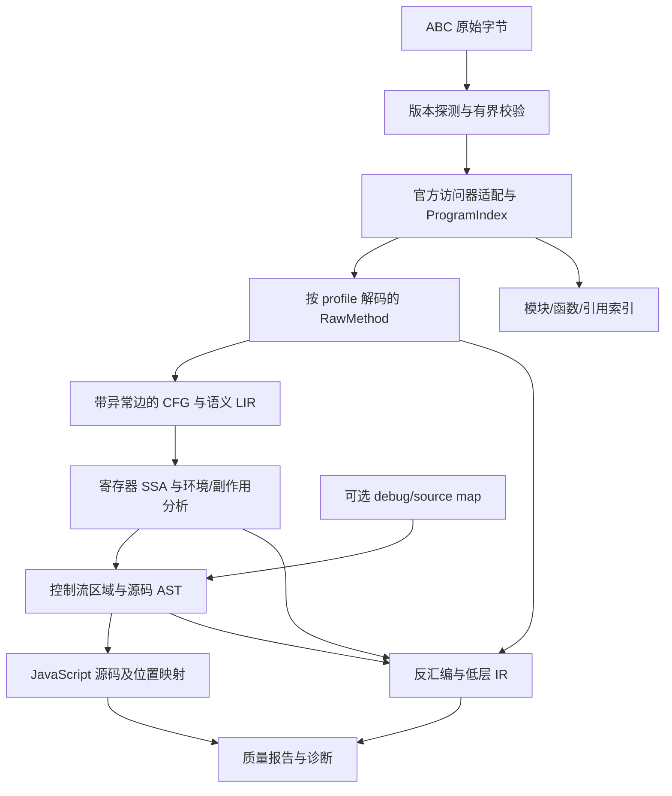

# 鸿蒙 ABC 反编译引擎设计方案

日期：2026-09-22。状态：供外部模型和人工审阅的设计草案，尚未开始引擎实现。

## 1. 目标与关键决策

使用 C++ 实现可独立调用的 ABC 反编译引擎，生成**语义可信正确、便于分析的源码**。正确性优先于外观相似度；需要恢复的核心是计算、控制流、异常、闭包、模块与可观察副作用。

用户已确认：参考实现固定为官方 `OpenHarmony-v7.0-Release` 标签；输入必须兼容旧版 ABC，不能因参考源码升级而取消旧版本支持。工程实现还须遵循根目录 [AGENTS.md](../../../AGENTS.md) 中的 8 项项目规则。

推荐决策如下：

1. 第一条产品路线为 ArkTS-Dyn/JS 动态 ABC，输出 JavaScript 源码；名字、模块路径和可验证的结构尽量保留，类型提示放在附属元数据中。静态 ArkTS ABC 是后续独立前端，不与动态指令表混用。
2. 复用官方 `libpandafile` 数据访问能力和 ISA 定义，建立版本适配层；反编译的语义 IR、控制流结构化和源码 AST 自主实现。
3. `abc2program`、`ark_disasm` 用于对照；`libabckit` 用作可选图分析对照和研究工具，不作为唯一生产前端。
4. 指令提升先保留寄存器、累加器、词法环境、异常和执行顺序，再构造 SSA。禁止直接拼接反汇编文本生成源码。
5. 无法确定语义的函数输出有字节码位置的低层 IR 和明确诊断，不伪造源码、不静默省略、不生成返回 `undefined` 的占位函数。
6. 建立独立的历史版本兼容测试矩阵；现有 5 个 ABC 是必须通过的首批真实样本，而非全部兼容范围。
7. 函数级异步、并行、懒加载是默认架构契约，从 P0/P1 建立；目标 JS 的 async 语义恢复是另外的语义任务。
8. 优先采用成熟算法，明确输入规模与复杂度；超过 200 项时避免平方及以上算法。内部语义全部类型化，不通过字符串或魔法数字分派。

配套专项设计：[算法与性能约束](../../design/algorithms.md)、[函数任务调度](../../design/method-tasks.md)。批量样本与静态 ABC 跳过规则见 [测试语料说明](../../../tests/corpus/README.md)。这些文档共同构成审阅材料。

本方案不承诺逐字符恢复源码、恢复已擦除的 TS 类型和注释、恢复混淆前命名，或仅从 ABC 还原完整可构建的 DevEco 工程。ArkUI 装饰器和声明式 UI 外观不作为首版目标。

## 2. 已核实的材料与基线

### 2.1 官方参考版本

官方 manifest 指定 GitCode。实际查询发现 GitHub 镜像同名标签的提交不同，因此最终统一使用 `https://gitcode.com/openharmony/`，同时固定标签对象和解析后的提交。

| 仓库 | `OpenHarmony-v7.0-Release` 对应提交 |
|---|---|
| manifest | `2cf9dc1ee5c1738f1aa5ef31a96c4de705e8bd1f` |
| arkcompiler_runtime_core | `3e147bb76e0b622cc2e4399ef954b030c0639691` |
| arkcompiler_ets_runtime | `f04900cf951c66c2ea18b2bab5b591d5336c34b9` |
| arkcompiler_ets_frontend | `c754cf6300873cdd8cdb71c7340a98abfd885389` |
| arkcompiler_toolchain | `82671745a88cc0cce78ba1e6f6266a9ef5cea045` |

本次已更新原工作区中的 24 个官方仓库；完整锁定清单见 `docs/reference/openharmony-v7.0-release.lock.json`。旧代码、旧 `.repo` 与生成目录保存在 `~/arkruntime-backup-before-v7.0-20260922/`。4 个独立构建来源的仓库及旧预编译工具保留，并未宣称属于 7.0 发布集。新工作区的管理方式见 `~/arkruntime/REFERENCE_BASELINE.md`。

这里只验证了源码检出，不代表已构建可用的 7.0 编译器、解释器或反汇编器。当前设计证据来自源码静态阅读、ABC 文件头和配套文件检查，尚无“所有样本可完整反编译”的实测结论。

### 2.2 样本清单

实际样本目录为 `~/sample/abc_with_code`，不是 `~/samples/abc_with_code`。

| 应用 / 文件 | 大小（字节） | 文件头版本 | 文件头 class 记录数 |
|---|---:|---|---:|
| Immersive/modules.abc | 293544 | 13.0.1.0 | 45 |
| MultiCommunityApplication/modules.abc | 514872 | 12.0.2.0 | 54 |
| pasteboard/modules.abc | 112024 | 12.0.6.0 | 19 |
| push-kit-sample-code-clientdemo-arkts/modules.abc | 113684 | 12.0.6.0 | 24 |
| push-kit-sample-code-clientdemo-arkts/widgets.abc | 12476 | 12.0.6.0 | 10 |

5 个文件均包含 `PANDA\0\0\0` 魔数。class 记录数是容器元数据，不能直接等同于用户定义的 JS class 数量。

配套文件有 116 个 `.ts`，分应用按内容去重后分别为 35、45、10、15 个，共 105 个；未发现 `.ets` 文件。其中可见 `ViewPU`、`ObservedPropertySimplePU`、`initialRender`、回调、模块导入和异步代码，说明对照文件至少部分是 ArkUI 转换后的 TS。`pasteboard` 存在重复目录，不得将重复源码计入独立测试样本数。

`sourceMaps.map` 是聚合 JSON；已检查的 `src/sourceMaps.json` 是逐行 `{key,val}` JSON，分别包含 35、45、15 项。已检查的聚合 map 无 `sourcesContent`。`.protoBin` 是编译中间产物，可用于研究对应关系，不能当作核心引擎的必要输入。

额外批量语料实际位于 `~/sample/abc`，清点到 895 个 ABC、共 1939093000 字节。本轮未做类型识别。用户明确其中存在静态 ABC，暂不支持；首次验证时将逐文件分类、内容指纹和证据持久化到 `tests/corpus/abc-index.json`。后续复用有效分类跳过静态样本，不重复识别、不修改 ABC 本体，也不把未知版本或解析失败误标为静态。

### 2.3 直接影响设计的源码证据

以下路径均相对于 `~/arkruntime/arkcompiler/`，固定为上表提交：

| 证据位置 | 已核实事实 | 设计影响 |
|---|---|---|
| `runtime_core/isa/isa.yaml:109` | 当前版本 24.0.0.0；API 与 ABC 版本多对一；列出 11.0.0.0、11.0.1.0 不兼容版本 | 不使用 API 大版本猜测 ABC 布局，不把运行时允许范围当作反编译认证范围 |
| `runtime_core/libpandafile/file.h:546`、`file.cpp:792` | 文件头 literal-array 索引存在与否以 12.0.6.0 为分界 | 13.0.1.0 样本头的 `0xffffffff` 是保留字段，不能读作数组长度 |
| `runtime_core/libpandafile/file.h` | 存在分区索引及按 entity 解析的 `Resolve*Index` | 区分文件偏移、局部索引、模块索引和实体 ID |
| `runtime_core/libpandafile/code_data_accessor.h` | Code 携带寄存器/参数数量和 try/catch 元数据 | CFG 从字节边界和异常范围建立 |
| `ets_runtime/ecmascript/interpreter/interpreter-inl.cpp:1816` | `add2` 左操作数来自 vreg、右操作数来自 acc，慢路径可能抛异常 | 操作数次序、隐式转换、副作用与异常必须显式建模 |
| 同文件 `:1347`、`:4024`、`:6067` | call-this 单独处理接收者；异常入口写 acc；词法读取逐级遍历环境 | 不能把调用、catch 状态和闭包简化为普通寄存器复制 |
| `runtime_core/libabckit/doc/implementation_description.md` | 建图涉及 panda_file → pandasm → panda_file → compiler Graph | 必须验证原始 PC 保真性及转换影响，不能默认图就是原始字节码的无损表示 |
| `ets_frontend/docs/ES2Panda_Knowledge_Base.md` | es2panda 与 ets2panda 为不同路线 | 动态 ABC 主要对应 es2panda 编译逻辑 |

任务类别为动态 ABC 反编译架构设计与参考仓库版本固定。已阅读相关仓库说明、`AGENTS.md`、动态前端知识库、模块知识库、文件访问器、ISA、解释器与 AbcKit 设计文档。遵循的边界是：不改变上游 ABC 格式和 opcode、不混用动态/静态 API、不手改生成文件。本轮使用设计与完成前验证流程，不开始实现。

## 3. 三种技术路线

| 路线 | 优点 | 风险与成本 | 结论 |
|---|---|---|---|
| 官方文件访问器 + 生成式解码 + 自有反编译 IR | 保留 PC、可控旧版本适配、精确表达副作用；复用格式知识 | 需要实现 CFG、SSA、结构化和语义测试 | 推荐 |
| 直接以 AbcKit Graph 为全部基础 | 快速获得模块和图 API，可参考官方图算法 | 转换与优化可能改变形态；原始 PC 对应需要验证；动态/静态构建依赖较多 | 作为对照工具，首轮技术验证可量化优势 |
| 完全独立重写文件解析、所有 ISA 与语义 | 最小运行时依赖、完全控制格式 | 重复官方已有工作，旧版格式遗漏和语义偏差风险高 | 不作为起点；仅为官方访问器无法处理的明确历史布局补兼容代码 |

LLVM IR 不作为核心语义 IR：动态对象、词法环境、模块活绑定和 JS 异常会被过早降低。也不把反汇编字符串或上游编译器内部 Graph 暴露为公开 API。

## 4. 版本兼容设计

### 4.1 三个独立版本轴

`BytecodeProfile` 包含：格式方言、4 字节文件版本、容器布局、指令编码表、操作语义修订、模块/字面量布局、调用约定、证据来源与认证状态。格式版本和 opcode 语义可以共享实现，但只有逐项核对后才能共享。

另设输出 `schema_version` 和引擎版本，用于 JSON/IR 与缓存兼容。不得把 OpenHarmony 发布号、SDK API 号、ABC 头版本、工具 API 版本视作同一个数字。

识别顺序：有界读取头 → 版本和已知布局 → 语言/记录元数据交叉验证 → 选择唯一 profile → 完整验证。仅凭 `.abc` 后缀或 `PANDA` 魔数不能判断动态/静态。存在歧义时报告候选与证据，禁止静默按最新布局解析。

### 4.2 支持矩阵与历史版本政策

| 输入族 | 计划支持方式 | 认证要求 |
|---|---|---|
| 12.0.2.0、12.0.6.0、13.0.1.0 动态 ABC | 首批强制目标，覆盖当前所有样本 | 文件、指令、语义与源码四层各自通过测试 |
| 9.0.0.0、11.0.2.0 动态 ABC | 首个正式兼容里程碑纳入，包含实际使用的 deprecated/wide 指令 | 对应年代真实 ABC + 历史编译器生成用例 + 行为对照 |
| 24.0.0.0 动态 ABC | 7.0 参考实现的当前格式一并纳入 | 7.0 工具生成用例和新指令专项测试 |
| 更早的动态格式，包括可能的 0.0.0.x | 历史兼容子项目，逐个有证据的 profile 实现，不能混用静态格式假设 | 补充对应历史源码快照和工具，不因 7.0 min_version 较低就宣称全部支持 |
| 11.0.0.0、11.0.1.0 | 7.0 明示不兼容；如需支持，使用独立历史 profile | 禁止修改版本头后强行交给新 reader；需历史格式和样本证明 |
| 静态 ArkTS ABC | 后续独立前端，首版识别并明确报告不支持 | 独立静态样本、语义和类型模型 |
| 未知未来版本、厂商私有扩展 | 保留原始数据和明确诊断 | 未知布局不猜长度、不顺延解码 |

此表是实施目标，不是当前已具备的能力。正式发布时应生成逐版本 `decode / lift / source / test` 矩阵，不能用“支持 OpenHarmony 7.0”代替兼容说明。

参考源码以 7.0 为主。历史差异证据可来自官方旧标签的最小只读快照，记录 SHA；不把全部历史运行时链接进引擎。7.0 编译器的旧 API 输出可作为补充用例，不能代替历史编译器，因为新编译器可能使用新的 lowering。

### 4.3 解码表与语义表分开

编码层从固定 ISA YAML 和上游生成脚本导出 C++ 表：opcode/prefix、长度、位域、符号性、寄存器范围、ID 种类、acc 读写。历史变体由显式差异表补充，禁止全局散布版本判断。

语义层逐 opcode 定义：操作数顺序、隐式输入、正常输出、抛异常行为、控制流、heap/env/module 读写、是否调用用户代码、是否挂起。每条规则记录解释器/运行时路径与微型测试。

特别注意：7.0 ISA 中部分动态指令组标注 `x_none`，而解释器仍可能经运行时调用抛异常。因此不能从 YAML 自动推出 `pure` 或 `nothrow`。尚未核验的操作默认保守副作用；语义未知则停止该函数的可信源码输出。

## 5. 总体流水线



### 5.1 组件职责

| 组件 | 输入与输出 | 所有权和依赖 |
|---|---|---|
| `AbcFrontend` | 文件 → `ProgramIndex`、按需 `RawMethod` | 独占不可变文件存储；封装上游 accessors |
| `ProfileRegistry` / `Decoder` | 版本、字节 → 带 PC 和已解析引用的指令 | 只读生成表；不依赖运行时 VM |
| `SemanticLifter` | RawMethod → LIR + 异常/效果信息 | 按 profile 的规则；不生成源码文本 |
| `FlowAnalysis` | LIR → CFG、dominators、SSA、循环区域 | 函数级所有权；所有 pass 后执行 verifier |
| `ScopeRecovery` / `ModuleRecovery` | 环境、定义、元数据 → 作用域与模块模型 | 全局只读索引 + 函数间事实，不进行猜测式内联 |
| `Structurer` | CFG/SSA → 区域树 | 必须覆盖语义边；失败返回可诊断状态 |
| `SourceEmitter` | 区域树/表达式 → AST → JavaScript | AST 管理优先级、命名和转义，不能直接拼字符串表达式 |
| `ReportWriter` | 所有产物 → JSON、映射、统计、诊断 | 输出 schema 独立版本化 |
| `MethodScheduler` / `MethodCache` | 函数请求 → 共享任务与不可变结果 | 有界执行器、请求去重、背压、取消；不承担函数分析逻辑 |

采用 C++20、CMake/Ninja；首发 Linux x86_64。核心是静态/共享 C++ 库与薄 CLI。运行时不要求 Python、Node 或完整 VM；Ruby/YAML 等仅用于构建期生成表，测试工具可使用脚本。

上游依赖固定 SHA，通过独立适配 target 导入，不把整个 OpenHarmony 编译器和 GC 搬入核心。先构建最小文件访问依赖；官方工具可在单独 GN 环境构建为测试工具。旧 standalone 脚本和 prebuilts 的兼容性属于首轮验证事项，不能默认可用。优先复用现有 JSON、测试库等依赖；暂不引入 LLVM、Boost Graph 或新 JS VM。

### 5.2 数据模型的必要约束

- 身份使用强类型 `FileId / RecordId / MethodId / EntityOffset / BytecodePc / LocalIndex / ValueId / BlockId`，不得都用裸整数互换。
- 函数稳定身份至少为文件 hash + method entity ID；原始方法名不是唯一键。
- `InstructionOrigin` 保留 method ID、原始 PC、长度、原始字节及 profile；表达式可以关联多个、不连续的原始区间。
- `ProgramIndex` 保留记录、方法、字面量、模块请求/导出、调试信息及引用关系。按需读取方法，避免每个函数重复解析全文件。
- 每个函数独占 arena/容器；外部 API 不暴露 arena 指针、上游指针或内部 Graph 类型。失败通过显式结果和诊断传递。
- JSON 和 IR 是分析产物，不作为内部 pass 间序列化中转层。
- `Op`、`EdgeKind`、`Effect`、`MethodState`、`EmitKind`、`DiagCode` 等使用枚举和结构化载荷；多态载荷采用受约束的 variant。版本使用数值结构，不比较点分字符串。
- 字符串仅承载真实名字、字面量、路径和边界序列化标签；禁止从打印后的 IR、opcode 名称或诊断文本推回语义。格式宽度、哨兵、ABI 槽位和预算使用有来源的命名常量或生成表。
- 名字短且有领域含义；避免无明确职责的 Manager/Helper/Utils/Data。单个文件围绕一项格式、算法或恢复规则组织；生成表留在构建目录。

## 6. 文件解析与指令解码

先只支持裸 ABC；HAP/ZIP 解包放在独立输入层，后续再加入。读取不执行 ABC，也不加载其 native 模块。

校验包括文件大小、加法/乘法溢出、索引分区范围、实体种类、ULEB/SLEB 长度、MUTF-8、指令边界、寄存器范围、跳转目标、字面量嵌套深度和引用循环预算。`0xffffffff` 等哨兵值依 profile 解释；不对输入直接 `reinterpret_cast` 后无界遍历。

官方访问器复用不等于自动获得完整输入安全性。适配层对可预知范围做校验，并将上游调用放入受限分析 worker；worker 崩溃或超预算转为文件诊断。后续若要提供纯进程内不可信输入 API，应以访问路径审计和 fuzz 为前置条件。引擎不再另写一套完整格式 parser 作为“校验层”；上游不足处逐项增加有测试的有界读取补丁或历史 reader。

字符串解码保留 JS UTF-16 语义，包括非 BMP、嵌入 NUL 和必要的孤立 surrogate 转义；不能把 MUTF-8 误作普通 UTF-8。字面量保留 NaN、负零、Infinity、BigInt、正则标志、数组 hole 与 `undefined` 的区别。

局部索引使用所属 method/entity 的索引区解析，不能把 16 位 operand 当全局字符串编号。模块请求索引与字面量引用使用各自的表。class、method 与 module 在容器中的组织不直接等同于源代码结构。

每个方法从 PC=0 解码至声明的 code_size。未知 opcode 长度会使该方法后续边界不可确定，此时只保留已确认前缀和原始余段，不能猜一个字节继续解码。其他已独立界定的函数继续处理。

## 7. 语义 IR 与正确性约束

### 7.1 两级 IR，避免过早表达式化

LIR 为接近机器状态的有序操作列表：寄存器、acc、环境指针、模块槽、控制流和异常出口全部明确。SSA IR 只将可安全版本化的标量状态转成 SSA，表达 `LoadProperty`、`StoreProperty`、`Invoke`、`Construct`、`CreateClosure`、`EnvLoad/Store`、`ModuleLoad/Store`、`Suspend/Resume` 等语义节点。

动态值默认是 `JsValue`；可进行局部类型推断辅助输出，但推断不改变运行时转换规则。JS `+` 不能按 C++ 整数加法处理，浮点转换和比较不能借用宿主 C++ 的未定义行为。

指令契约至少包含：

| 属性 | 要求 |
|---|---|
| 输入与输出 | 明确 vreg/acc、隐式函数对象、this、new.target、env；正常与异常结果分离 |
| 控制流 | fallthrough、branch、return、throw、suspend、resume 分开表达 |
| 副作用 | heap/env/module 读取与修改，可能调用用户代码，可能抛异常 |
| 身份 | 对象/闭包分配不能因值看似相等而被合并 |
| 来源 | 版本 profile、原始字节范围、语义规则与验证用例 |

初版采用保守的单一效果链，不做复杂 heap alias 分析。属性读也可能触发 getter/Proxy，类型转换可能调用用户 `valueOf`，不能认为“只有写和调用才有副作用”。效果链分出正常和异常结果，抛异常前已发生的外部修改必须保留。

### 7.2 CFG 与异常状态

普通基本块边界包括函数入口、跳转目标、分支后继、终结指令之后和 try/handler 范围边界。保护区内每个可能抛异常的操作都需一个明确的异常转移点；首版直接拆块，正常结果只能沿正常边定义。保护区外至少保留通向函数异常退出的语义出口。

异常边的目的 handler 和优先级按对应版本解释器选择规则建立，不能无差别连接所有 catch。handler 入口的 acc 是异常对象；vreg 与 env 来自具体抛出点的状态；heap 效果可能已经部分提交。异常边的标量合并不能使用整块结束时的寄存器状态。

维护两种分析视图：普通控制流用于普通循环和区域候选；完整控制流用于数据流正确性、异常状态和边覆盖验证。SSA 中 exceptional predecessor 必须实际参与，不能为了结构化方便删掉。

`finally` 不仅处理 throw，还可能处理 return、break、continue，且 finally 内的 abrupt completion 能覆盖原结果。IR 显式保留 completion 的类别、值与目标；禁止把编译器复制的 finally 片段仅凭文本相似度合并。

### 7.3 SSA 构造与销毁

支配树采用 Lengauer-Tarjan，phi 放置采用活跃性剪枝的 IDF，重命名沿支配树和稀疏 def/use 链进行。具体算法、复杂度与引用见[算法专项设计](../../design/algorithms.md)。不物化所有块的完整 frontier，也不为每个寄存器重复扫描整图；多变量 SSA 的总工作量与 phi 膨胀必须单独计费，不能笼统承诺线性。入口参数按 profile 的真实 ABI 区分隐藏参数和用户参数，不固定减去某个魔数。

词法环境中的可变 cell、模块绑定、heap 属性不直接当普通 SSA 局部变量。环境对象身份可以进入 SSA，槽位读写仍保留效果；只有证明未逃逸且没有别名修改后，才允许局部提升。

去 SSA 时使用按边的并行复制：拆分必要的 critical edge，用临时变量解决复制环。异常边不能随意插入普通可执行块；通过抛出点前的必要赋值、handler 参数模型或保留更低层表示解决。

每次变换后验证：定义支配使用、phi 输入与前驱匹配、终结指令完整、引用存在、异常状态有效、效果顺序未倒置。完整 CFG 对不可达块仍保留索引和原始输出；不能未经说明把它们从审计产物抹掉。

### 7.4 闭包与词法环境

建立环境分配、parent 链、slot、读写、捕获和生命周期模型。`level, slot` 是相对于运行时环境链的寻址，不是函数层数，也不是永远固定的源变量编号。

需要正确处理：多个闭包共享可变绑定、循环逐迭代绑定、环境入栈/出栈、TDZ/hole、异常路径中的环境状态，以及箭头函数的 lexical this/new.target/super。闭包创建点与方法体实体是不同概念，不能将函数对象一概提升为函数声明。

能确定共享 cell 对应源码词法绑定时，生成嵌套函数与 `let/const`。不能确定时保留显式环境操作；只有环境辅助实现具备完整已测试语义时，才可输出带辅助库的低层 JS。否则输出 IR，不生成看似普通但捕获值错误的源码。

### 7.5 调用与求值顺序

`Invoke(callee, receiver, args)` 与 `Construct(callee, newTarget, args)` 是不同操作。普通调用、带 this 调用、super 调用、spread 与 range 形式归一后仍保留真实参数顺序和参数数量。

例如字节码先读取 `obj.method`，再执行可能修改 `obj.method` 的参数表达式，就不能错误地把读取延后。即使结果只使用一次，表达式内联仍须保证效果链、异常保护区和条件执行关系不变。

不能一般性地用 `fn.call(receiver, ...)` 代替低层调用，因为 `call` 属性可能被覆盖；随意使用可被修改的 `Reflect.apply` 也有同类问题。只有匹配原求值顺序时才生成自然调用语法；否则使用有明确可信 intrinsic 契约的已验证辅助调用，或保留 IR。

### 7.6 类型与“正确”的边界

类型擦除后不编造 interface、泛型或强类型参数。原始/推断/生成的名字与类型分别标注来源，类型提示不能驱动改变语义的优化。

目标等价关系是：相同参数和规定的运行环境下，保留正常返回、异常、对象身份关系、可观察属性/全局/模块修改、外部调用参数与顺序，以及异步完成顺序。允许局部变量重命名和无影响的临时变量；不要求字节码二进制一致、栈行号一致、函数源码反射文本一致或性能一致。运行环境假设必须列入报告，不能隐藏。

局部规则具备可检查的前置条件和测试证据，并不等于获得任意程序的形式化等价证明。报告使用具体支持状态与证据，不给出未经校准的“语义正确率 99%”。

## 8. 控制流、模块和高级结构恢复

### 8.1 结构化策略

顺序区域、if/else、自然循环优先。结合 dominator、post-dominator、SCC 和循环出口恢复 `while/do/for`、`break/continue`；无出口 SCC 单独处理，不能为了 post-dominator 算法强加具有程序语义的退出路径。

`&&`、`||`、`??`、三元表达式和 optional chaining 仅在分支值、短路条件、求值次数、异常行为全部匹配时恢复。不把普通真假判断误作 nullish 判断，不把相邻比较链无条件改为 switch。

switch 恢复需保证比较语义、顺序、case 副作用与 fallthrough。无法满足时保留 if 链，仍可属于正确源码。

不可约普通控制流可用显式 `while/switch` 状态机保留；启用前必须证明不存在丢失的异常保护区、词法环境或挂起关系，并设置复制/膨胀预算。不能把跨异常区域的任意 CFG 都套进一个 switch 并宣称等价。无法验证则输出低层 IR。

### 8.2 异常结构恢复

先恢复 try/catch 的区域边界和 handler 状态，再识别 finally。存在交叠、共享 handler 或难以表示的入口时，以原始异常表和低层区域为准。绝不通过移动可能抛异常的表达式来“修整”源码外观。

### 8.3 模块与类

保留 ES Module、CommonJS、脚本以及外部/native 模块的区别。模块变量读取必须保持 live binding 和 TDZ；导出值变化不能变成初始化时的快照。循环依赖以 SCC 记录，不重排模块初始化来得到更好看的源码。

恢复 import/export 优先依据模块请求、导入/导出表和 `moduleRecordIdx` 等元数据；`@ohos:`、`@bundle:`、`@normalized:` 等 specifier 保留原值。用户选择的展示路径与运行时模块身份分别保存。模块槽位不能一律根据方法名猜测。

类恢复结合 constructor、`defineclasswithbuffer`、方法字面量、继承与属性定义操作。正确保留 static/instance 区分、getter/setter、属性 descriptor、计算属性名求值时机、super 及私有成员语义。字面量对象中 `__proto__` 的特殊规则同样必须保留。

命名优先级：真实元数据/调试局部变量 → 已验证的作用域信息 → 明确数据流角色 → 稳定生成名。重命名局部标识符需避开保留字和捕获冲突；不能为了美观改写运行时属性名、导出名或模块路径。

### 8.4 异步和生成器

它们不是几个 opcode 的文本替换。IR 明确保存 suspension、恢复输入、resume mode、normal/throw/return 恢复路径以及关联异常区域，不能把 suspend 当普通 fallthrough 或最终 return。

只有完整状态协议可对应到语言结构时才输出 `async/await`、`yield`、`yield*`；验证 promise resolve/reject、thenable、finally 和嵌套挂起行为。缺少部分协议证据时输出显式状态模型，并报告源码恢复未完成。

现有样本已经包含 async，因此异步处理属于满足样本目标的主线路线，不以“留给未来”替代交付。首轮可暂时降级，但正式样本验收必须包含代表性异步方法。

### 8.5 ArkUI

默认输出真实存在的 `ViewPU`、属性包装器、`initialRender`、组件 API 调用与回调。识别“这是 ArkUI 生成代码”可作为分析标签，但不能删除初始化、订阅、清理或更新路径。

恢复 `@State`、`@Component`、声明式 `build()` 应在核心正确后作为独立可选展示插件，并保留转换前源码和证据。首版不以这类不可逆逆变换衡量成功。

## 9. 输出协议与失败语义

### 9.1 产物

| 产物 | 含义 |
|---|---|
| `src/` | 满足语义覆盖和结构验证的 JavaScript 模块/函数源码 |
| `lowered/` | 使用显式状态或已验证辅助实现的可解析 JS；标注运行依赖 |
| `ir/`、`disasm/` | 完整或局部低层表示；未知段保留原始 bytes |
| `index.json` | 模块、函数、引用、导入导出、调用候选与动态未知目标 |
| `mapping.json` | 输出 AST/文本位置到 method/PC 区间的映射及命名来源 |
| `report.json` | 输入哈希、profile、工具基线、函数状态、指标、诊断、假设 |

source map/debug 的来源在报告中可见。核心流程默认不读取相邻 `.ts/.ets/.protoBin`，source map 需要显式开启；测试时将参考源码放在隔离目录。

源码状态由 `EmitKind` 枚举区分 Structured、Lowered、PartialIr、DecodeError，仅在 JSON 边界映射为 `structured-source`、`lowered-source`、`partial-ir`、`decode-error`；核心不能比较这些字符串。另用独立字段记录 `tested` 及测试范围，不能把 `structured-source` 偷换成“已在所有输入上证明等价”。已知 ArkUI/系统 API 是显式外部环境依赖，不因缺少整个 OS 就算语义未知；不认识的内部字节码 intrinsic 则不能冒充普通外部 API。

包含未恢复函数的模块必须标记不完整；可导出已恢复函数片段及缺失符号索引，但不生成悄悄替换行为的空函数。跨函数调用保留真实调用关系，不因被调方法无法恢复就错误内联或删掉调用。

### 9.2 诊断与工具接口

诊断包含 `DiagCode`、文件/记录/方法 ID、原始 PC 或文件偏移、profile、阶段枚举、结构化载荷和已保留的产物。JSON 分类标签包括 unsupported-profile、malformed-input、unknown-opcode、unresolved-reference、unsupported-semantics、unstructured-region、resource-limit、internal-invariant-failure；这些仅为边界表示，控制流只依据强类型错误码。

建议 CLI 为 `inspect`、`disasm`、`decompile` 三个明确子命令，可筛选模块/函数，输出 JSON/CFG/DOT 和取消长任务。默认 decompile 不完整时返回独立非零退出码；显式 `--allow-partial` 可用于批量导出，但报告不能更改真实状态。具体命令名和参数在接口实现阶段冻结。

结果稳定排序，以稳定身份生成名字。相同输入、profile 和选项生成相同源码/语义报告；时间耗费等运行数据放独立字段。方法缓存键包含输入 hash、profile/语义规则/引擎版本与选项，防止更新规则后误用旧结果。

### 9.3 资源与并发

按文件/函数预算限制字节数、实体数、指令数、边数、递归深度、字面量递归、区域复制、内存和运行时间。预算用尽是资源诊断，不是“无效程序”或“成功反编译”。

函数请求默认异步提交，在有界执行器上并行推进，方法体和分析结果按需加载。只读 ProgramIndex 可以共享，每个分析任务独占可变状态；相同键的在途任务去重，完成结果不可变。上游非线程安全访问限制在按需加载队列或独立 reader/进程内，不预先物化全文件。提供取消、背压、缓存预算与确定性输出；禁止每函数创建线程或在饱和池中阻塞等待子任务。生命周期和验收要求见[调度专项设计](../../design/method-tasks.md)。

串行调试模式使用相同任务接口，并行与懒加载从 P0/P1 验证，不能推迟到 P6。算法工作量、输出膨胀与峰值内存按[性能约束](../../design/algorithms.md)计费；预算耗尽保留已验证产物，不省略语义来伪装完成。

## 10. 验证体系与验收标准

### 10.1 四层验证

1. **二进制与解码对照**：逐方法对比官方工具的 opcode、操作数、ID、PC/分支目标、字面量、异常表与模块表。文本格式差异先归一化，不通过模糊字符串相似度判定。
2. **IR 不变量与变换验证**：CFG/SSA/效果链 verifier；针对每条结构化规则做正例、近似但不等价的反例和交互组合。
3. **行为差分**：微型源程序 → 对应版本编译器 → 原 ABC 执行结果；反编译源码重新编译后在匹配运行时比较返回、异常、状态和调用轨迹。无相应运行时的版本明确记为未完成动态验证。
4. **真实样本评测**：以 5 个 ABC 为黑盒输入，旁边源码只作人工/自动对照，逐模块检查闭包、调用、类、异常和 ArkUI 回调等关键行为。

额外的 895 个 ABC 用于批量解码、健壮性、内存、调度和覆盖评测；缺少源码/行为 oracle 的样本不计为行为等价证明。先读取持久化分类清单，确认静态的样本记为明确跳过项，未知和失败单独统计。首次识别及失效重判的证据要求见[语料说明](../../../tests/corpus/README.md)。

重新编译后的 ABC 不要求二进制相等；反编译后“能解析”也不等于语义等价。7.0 编译器与 VM 不能无条件替代全部历史工具。差分工具链也可能共享 bug，因此还需手写语义期望、历史真实样本和反例测试交叉验证。

对依赖鸿蒙 API 的应用，使用确定性 mock 记录外部调用顺序、receiver、参数、回调、状态修改，并对异步调度建立明确模型。mock 只能证明该环境下的路径行为，不能宣称验证完整系统 API。可运行的真机集成测试属于后续扩展，不阻塞纯计算语义测试。

### 10.2 必须覆盖的难例

| 类别 | 关键用例 |
|---|---|
| 解码 | wide/deprecated/prefix、4/8/16 位寄存器、负跳转、截断立即数、跨索引区、MUTF-8、版本哨兵 |
| 动态语义 | 字符串加法、ToPrimitive 抛异常、NaN/负零、BigInt、hole/undefined、属性 getter/Proxy |
| 调用 | this 丢失、方法提取、callee 被参数表达式修改、range/spread、super/new.target |
| SSA | 菱形、循环 phi、复制环、未初始化寄存器、critical edge、同一块多个抛出点 |
| 闭包 | 共享计数器、多级捕获、for-let 逐迭代捕获、TDZ、异常退出后闭包、箭头 this |
| 异常 | 嵌套 catch、getter 抛出、finally 覆盖 return/throw、break/continue 穿过 finally |
| 模块 | 循环依赖、live export 更新、re-export、动态/懒加载、CJS、外部 native 模块 |
| 异步 | await 正常/拒绝、thenable、finally 中 await、generator throw/return、嵌套挂起 |
| 结构化 | 无出口循环、多出口循环、不可约 CFG、switch fallthrough、短路有副作用 |
| 健壮性 | 畸形 header/ULEB/字符串、索引越界、引用循环、超大方法、取消和预算耗尽 |
| 调度 | 相同请求去重、单/多 worker 一致、订阅取消隔离、文件关闭、依赖环、缓存淘汰、背压、按需读取 |
| 规模 | 200/201 边界、几何递增图、深层循环、稠密边、跨变量重复扫描、操作计数与峰值内存 |
| 语料分类 | 静态结果复用、同路径内容变化、规则升级、未确定类型、解析失败不得误跳过、并发更新清单 |

采用 GoogleTest/CTest、ASan/UBSan、TSan、libFuzzer；先 fuzz profile 探测、reader、decoder，再拓展 LIR/CFG。测试、mock、fixture、golden、fuzz 与 benchmark 均放 `tests/`，通过独立构建目标运行；生产代码不得依赖测试辅助实现。回归样本必须保存失败输入和 profile；fuzz 无崩溃并不能证明语义正确。

### 10.3 防止“指标好看但结果错误”

分别报告：字节解码覆盖、opcode 编码变体覆盖、语义提升覆盖、函数源码恢复率、按原始指令数加权的源码覆盖、降级比例、行为测试通过率。分母明确列出所有有代码的方法、原始指令数和排除原因；生成器/匿名方法/框架方法不可静默排除。

5 个真实样本在前端里程碑要求：全部有代码方法枚举，全部指令可解码，所有可达引用可解释或明确分类，分支和异常边界全部验证。不能用“文件打开成功”作为完成条件。

首个源码发布里程碑的最低门槛：支持矩阵中承诺的微型行为测试全部通过；5 个样本各自至少 90% 方法且至少 90% 原始指令落在可信源码产物中；预先登记的业务入口、闭包、异常和异步代表性方法全部通过审阅/差分。未达门槛只能标为实验版本，剩余函数继续报告降级，不为达到比例放松语义规则。

90% 是建议的发布门槛，不是本次测得结果，也不是最终覆盖上限。P0 建立函数清单后冻结代表性方法列表，避免事后挑简单函数。最终目标仍是覆盖实际应用中的动态字节码语义。

测试无调试信息、开启调试信息、优化/未优化、merge/unmerged、混淆与未混淆组合。4 个应用数量有限，不能据此宣称通用性；至少将一个应用作为留出集，跨版本新增第三方真实样本。

## 11. 实施分期与交付门槛

当前只提交方案；以下阶段需在审阅后执行。各阶段应产生可运行产物和证据，不能连续数周只搭框架。

| 阶段 | 实施内容 | 完成判定 |
|---|---|---|
| P0 基线与可行性 | 固定依赖；构建最小 reader 和对照工具；建立类型化任务接口并验证有界执行器；生成样本 method/opcode/profile 清单；登记批量语料分类缓存 | 对照工具可重现；5 样本可做结构清点；静态样本有持久化证据；确定调度/适配边界和算法依据 |
| P1 多版本前端 | 首批 3 个旧格式 + 24.0.0.0 解码；函数体懒加载、异步并行请求/去重/取消；原始位置、引用、异常/模块元数据；有界读取和 fuzz | 5 样本全量解码一致；按需读取与并发隔离通过；批量测试复用静态跳过清单；开始规模基准 |
| P2 语义与分析骨架 | LIR、指令契约、完整 CFG、标量 SSA、效果链、闭包环境模型、verifier | 有副作用/异常的微型用例可检查；不输出未经验证的漂亮源码 |
| P3 基础可信源码 | 表达式、调用、分支、循环、去 SSA、普通闭包、模块和类；AST printer | 同步微型程序差分通过，已支持函数输出可解析 JS，原始映射完整 |
| P4 复杂语义与样本 | try/catch/finally、async/generator、复杂捕获、模块活绑定、ArkUI 转换后代码 | 达到样本发布门槛；关键业务/异步/异常方法均有证据 |
| P5 历史兼容认证 | 9.0.0.0、11.0.2.0 及 legacy 格式逐批接入、对应工具与实物样本；发布兼容矩阵 | 每个宣称支持的 profile 有对应历史证据和行为回归，不能只有新工具模拟 |
| P6 工程化 | 已有任务系统与缓存的性能调优、稳定性、CLI/库 API 定稿、打包与文档 | 确定性、资源限制、跨机器重现、版本矩阵回归通过；不在此阶段才引入并行 |

P5 的历史资料收集从 P0 开始，不能等核心全部写完才发现旧格式架构不兼容。P4 与 P5 的认证共同决定正式版本范围；尚未认证的历史 profile 不虚报支持。静态 ABC、HAP 输入、声明式 ArkUI 美化分别作为后续独立项目。

首个技术验证必须回答：`libpandafile` 是否能无损枚举这些旧样本、需要的元数据是否存在、各 opcode 家族实际分布、原始 PC 是否可全链追溯、能否独立构建最小适配层。若官方访问器无法处理特定旧布局，优先增加一个限定布局的 reader，而不是整体推翻架构。

## 12. 建议目录与扩展边界

```text
include/abcd/          公共库接口与结果类型
src/frontend/         版本探测、文件适配、ProgramIndex
src/bytecode/         生成表、版本差异、解码
src/semantics/        指令契约与 LIR 提升
src/ir/               LIR、SSA、verifier
src/analysis/         CFG、支配、循环、环境、模块
src/recovery/         区域、异常、类、闭包、异步恢复
src/emitter/          源码 AST、printer、位置映射
src/report/           JSON schema、诊断与指标
src/schedule/         函数任务、依赖、取消、有界缓存
tools/abcd/           CLI 与分析 worker
profiles/             版本支持、历史差异与来源记录
tests/unit/           按领域模块镜像组织的单元测试
tests/integration/    CLI、文件生命周期、调度、输入输出
tests/differential/   历史工具链和行为差分
tests/fuzz/           畸形输入与图变换 fuzz
tests/bench/          算法规模、吞吐、内存基准
tests/fixtures/       最小输入、golden、对照源码
tests/corpus/         外部批量样本清单、分类和跳过记录
docs/design/          按算法、调度等主题拆分的专项设计
docs/reference/       上游锁定与样本指纹
```

依赖方向为前端/解码 → 语义/IR → 分析/恢复 → emitter；报告消费稳定结果模型。上层不可反向依赖上游内部类。主实现保持 C++，不以 Python 或大模型推理承担生产语义恢复。

文件按格式、算法、恢复规则与调度职责划分；公共头文件小而稳定，生成表与编译输出留在构建目录。复杂语义和并发边界必须写面向 AI 及人工维护者的 Prompt-in-Code 注释，说明意图、前提、不变量、不可随意改动的关系、上游/算法来源与对应测试；不为简单赋值填充模板注释。注释必须与类型、verifier 和测试保持一致。

大模型可以审阅设计、建议命名或发现模式，但不能在核心路径中按概率填补缺失语义。规则引擎的每项变换必须可重复、可审查、可关闭并能定位到输入字节。

## 13. 外部审阅重点

建议将本文、根目录 AGENTS.md、算法/调度专项设计、语料说明及锁定清单一并交给其他模型，要求具体指出反例与修改位置，而不是只评价架构是否“完整”。

1. 官方 reader + 自有 IR 的边界是否合理；是否遗漏必须保留的元数据或能显著减小工作量的官方能力？
2. 多版本 profile 是否能覆盖历史索引布局、deprecated 指令、模块格式和调用约定；如何防止版本误识别？
3. 异常边的寄存器状态、部分已提交的副作用和 finally completion 是否存在反例？
4. 闭包共享 cell、循环词法环境、TDZ、this/new.target/super 的恢复条件是否足够？
5. 表达式内联、去 SSA、状态机 fallback 是否可能改变 getter、Proxy、异常和求值顺序？
6. 模块 live binding、循环初始化、async/generator 是否被错误简化；缺少哪些必要难例？
7. 失败状态与覆盖率指标能否阻止不可信源码被包装成成功结果？
8. 分期是否能尽早得到正确的可用源码；哪些模块应更早验证，哪些内容可延后？
9. 是否还有字符串语义、魔法数字、超过 200 项时的平方路径，或与异步/并行/懒加载默认契约冲突的设计？
10. 静态样本跳过记录能否防止重复识别，同时避免路径复用、规则升级或解析失败造成误跳过？

审阅输出建议采用：严重程度、问题位置、最小触发例、错误结果、修正建议、需要的测试。对未经验证的性能和覆盖推断，应明确标注假设。

## 14. 参考与审阅边界

上游事实以第 2 节固定提交的本地文件为准。可在线复核：[官方 7.0 manifest](https://gitcode.com/openharmony/manifest/tree/OpenHarmony-v7.0-Release)、[runtime_core 固定提交](https://gitcode.com/openharmony/arkcompiler_runtime_core/tree/3e147bb76e0b622cc2e4399ef954b030c0639691)、[ets_runtime 固定提交](https://gitcode.com/openharmony/arkcompiler_ets_runtime/tree/f04900cf951c66c2ea18b2bab5b591d5336c34b9)、[ets_frontend 固定提交](https://gitcode.com/openharmony/arkcompiler_ets_frontend/tree/c754cf6300873cdd8cdb71c7340a98abfd885389)。

官方 [AbcKit 实现说明](https://github.com/openharmony/arkcompiler_runtime_core/blob/master/libabckit/doc/implementation_description.md) 可辅助理解其元数据/图转换过程，但这个浮动镜像链接不用于确定本项目源码基线。

尚需实施验证的事项是：最小上游依赖构建、实际方法/指令统计、全部历史 profile 的可用工具、AbcKit 图与原 PC 的对应能力、样本行为对照与性能基线。这些已分配到 P0 及后续验收，不作为本次已经完成的成果。
